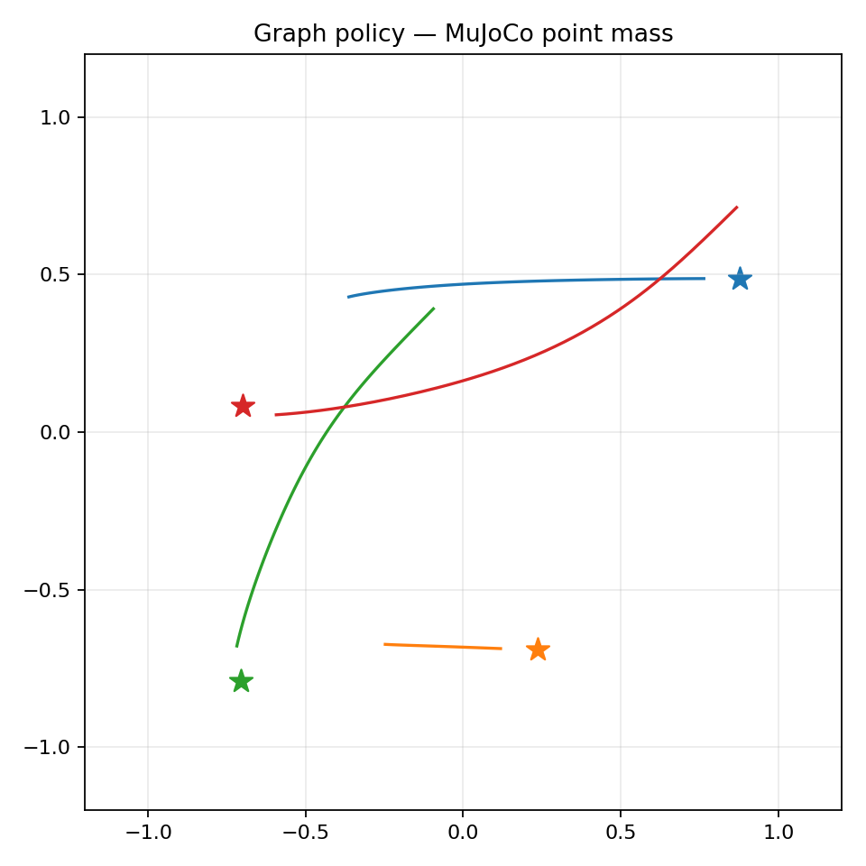

# 图控制器接入 MuJoCo 点质量任务

日期：2026-11-22  
环境：MuJoCo 3.2.7 / 2D point mass  
方法：PD 专家 → 图策略行为克隆 → DAgger

---

## 1. 结构

~~~text
obs (6)
→ input_gain 500×64
→ 500 节点稀疏图
→ K = 6 步消息传递
→ h[2:] (498 维)
→ policy head
→ action (2)
~~~

图：

~~~text
500 节点
每个 hidden 连接最近 4 个前驱
output 接最后 80 个节点
~~~

---

## 2. 训练

### 行为克隆

- PD 专家：80 episodes
- 样本：6991
- 12 epochs
- MSE：0.00255

### DAgger

- DAgger 1：+20 episodes，8728 样本
- DAgger 2：+20 episodes，10532 样本

---

## 3. 结果

| 阶段 | 成功率 | 平均步数 | 样本 |
| --- | ---: | ---: | ---: |
| BC | 1.00 | 101.27 | 6991 |
| DAgger 1 | 1.00 | 93.03 | 8728 |
| DAgger 2 | 1.00 | 95.90 | 10532 |
| 最终 50 episodes | **1.00** | **95.68** | 10532 |

PD 基线：

~~~text
success 1.00
mean steps 94.64
~~~

---

## 4. 结论

> 500 节点图 + K=6 + 线性 policy head 可以学会点质量到达目标。

但要说清楚：

- 这是 **模仿 PD**，不是从奖励中自己发现策略
- 图本身参与反传
- 成功率和 PD 基本一致
- 任务很简单，不能说明通用具身能力

---

## 5. 下一步

1. 不再用 PD 专家，改 PPO / CEM
2. 加障碍物
3. 目标随机化加强
4. 加视觉输入
5. 2000 节点图替换 500 节点
6. 真机前先做 sim-to-sim

---

## 6. 文件

- graph_policy.py
- train_graph_policy.py
- graph_policy_result.json
- graph_policy.png
- GRAPH_CONTROL_REPORT.md
