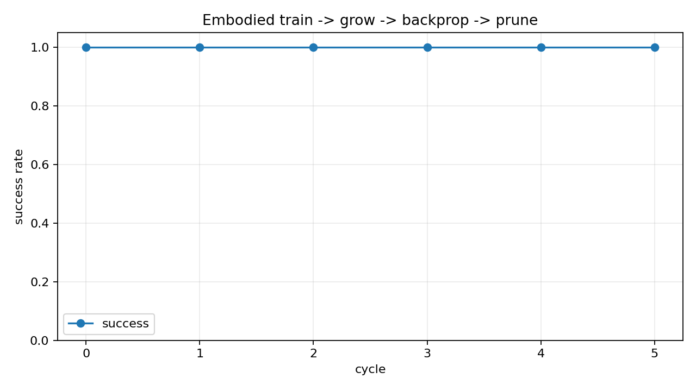

# 具身主线：训练 → 生长 → 反传 → 遗忘剪枝

日期：2026-11-22  
任务：MuJoCo 点质量到达目标  
图：500 → 600 节点  
循环：5 轮生长 + 1 轮最终评估

---

## 1. 循环

每轮：

~~~text
train 1 epoch
→ 生长 20 节点
→ backprop 1 epoch
→ 计算 usage / retention
→ 剪枝
→ 评估
~~~

时间变量：

~~~text
time_unit = 0.1 s
dt_units = round_seconds / time_unit
tau = 2.0 round-units
R_i = exp(-(now - last_used_i) / tau)
~~~

剪枝：

~~~text
usage < 0.0015 且 retention < 0.35 → alive = 0
~~~

---

## 2. 结果

| cycle | nodes | alive | success | steps | round s | dt units | pruned | retention mean |
| ---: | ---: | ---: | ---: | ---: | ---: | ---: | ---: | ---: |
| 0 | 520 | 520 | 1.00 | 93.85 | 1.949 | 19.49 | 0 | 0.0001 |
| 1 | 540 | 540 | 1.00 | 93.85 | 0.843 | 8.43 | 0 | 0.0148 |
| 2 | 560 | 560 | 1.00 | 93.85 | 0.866 | 8.66 | 0 | 0.0132 |
| 3 | 580 | 580 | 1.00 | 93.95 | 0.908 | 9.08 | 0 | 0.0107 |
| 4 | 600 | 599 | 1.00 | 93.95 | 0.916 | 9.16 | 1 | 0.0103 |
| 5 | 600 | 599 | 1.00 | 93.65 | — | — | 0 | — |

总耗时：8.274 s

---

## 3. 结论

> 机制跑通了，而且没有破坏点质量任务。

- 500 → 600 节点
- 成功率始终 1.00
- 只剪掉 1 个节点
- 遗忘曲线保留率非常低（约 0.01）

---

## 4. 为什么没有崩

这次和之前 2000 节点数学生长不同：

1. 新节点接入新 output
2. 新 output 的 head 列零初始化
3. 任务简单（点质量）
4. 每轮都重新训练
5. 剪枝非常保守

所以：

> 生长没有破坏策略，但也没有带来明显提升。

---

## 5. 问题

遗忘曲线衰减太快：

~~~text
retention mean ≈ 0.01
~~~

导致几乎所有节点都被视为“快忘了”，
剪枝规则却因为 usage 阈值太低，只剪掉 1 个。

---

## 6. 下一步

1. 把 tau 从 2.0 提到 5–10 round-units
2. 提高 usage 阈值，让真正未使用节点被剪
3. 每轮训练 3 epoch，再剪枝
4. 生长量从 20 降到 5–10
5. 在 Stage 1 单障碍上重复

---

## 7. 一句话

> “训练 → 生长 → 反传 → 遗忘剪枝”在具身点质量任务上跑通了，成功率保持 1.00；但只剪掉 1 个节点，遗忘曲线还需要重新标定。

---

## 8. 文件

- lifecycle_embodied.py
- lifecycle_embodied_result.json
- lifecycle_embodied.png
- LIFECYCLE_EMBODIED_REPORT.md
