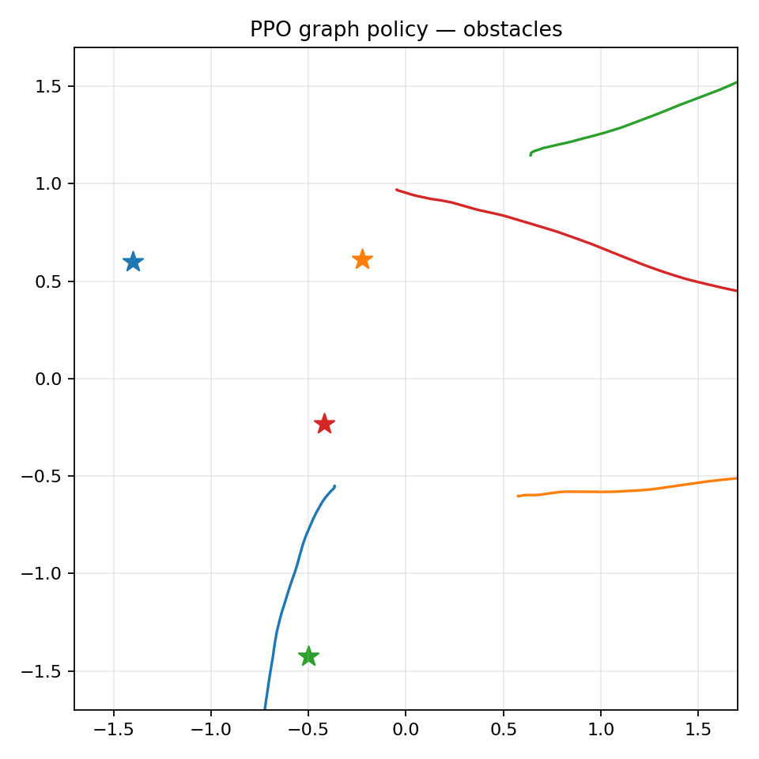

# PPO + 障碍物 + 强随机化

日期：2026-11-22  
环境：MuJoCo point mass + 3 obstacles  
方法：500 节点图 actor-critic，PPO，无 PD 专家

---

## 1. 环境

- 2D 点质量
- 3 个圆形障碍物
- 起点随机 [-1.3, 1.3]
- 目标随机 [-1.6, 1.6]
- 障碍物随机 [-1.1, 1.1]
- 重置时避开起点/目标
- 成功距离 < 0.14
- 碰撞惩罚 -0.3

观察 12 维：

~~~text
[px, py, vx, vy, tx, ty, obs1_rel, obs2_rel, obs3_rel]
~~~

动作 2 维。

---

## 2. PPO

- 500 节点图
- K = 6
- actor + critic
- 40 updates × 2048 steps
- gamma 0.99, lambda 0.95, clip 0.2

---

## 3. 结果

| 阶段 | 成功率 | 平均步数 |
| --- | ---: | ---: |
| update 0 | 0.0 | 250 |
| update 20 | 0.0 | 250 |
| update 35 | 0.1 | 246.3 |
| final 50 episodes | **0.04** | **247.08** |

最终碰撞次数：142

---

## 4. 结论

> PPO 这版基本失败。

原因：

- 强随机化 + 3 障碍物使任务明显变难
- 500 节点图 + K=6 特征不够
- 奖励只有距离 + 碰撞惩罚，稀疏
- 没有课程学习
- 40 updates 太少
- 单环境 on-policy 采样效率低

---

## 5. 和 PD 模仿对比

| 方法 | 成功率 | 步数 |
| --- | ---: | ---: |
| PD 专家 | 1.00 | 94.64 |
| PD 模仿 + DAgger | 1.00 | 95.68 |
| PPO + 障碍 | 0.04 | 247.08 |

所以：

> 没有专家后，当前 PPO 配置还学不会。

---

## 6. 下一步

1. 课程学习：先无障碍、小范围，再加障碍
2. 奖励塑形：接近目标、避障、速度惩罚
3. 更多并行环境
4. CEM / ES 作为对照
5. 简化障碍布局

---

## 7. 一句话

> 障碍物和强随机化已加上，但 PPO 从零学习失败；下一步应先课程学习或换 CEM/ES。

---

## 8. 文件

- point_mass_obstacles.py
- ppo_graph.py
- ppo_graph_obstacles_result.json
- ppo_graph_obstacles.png
- PPO_OBSTACLES_REPORT.md
