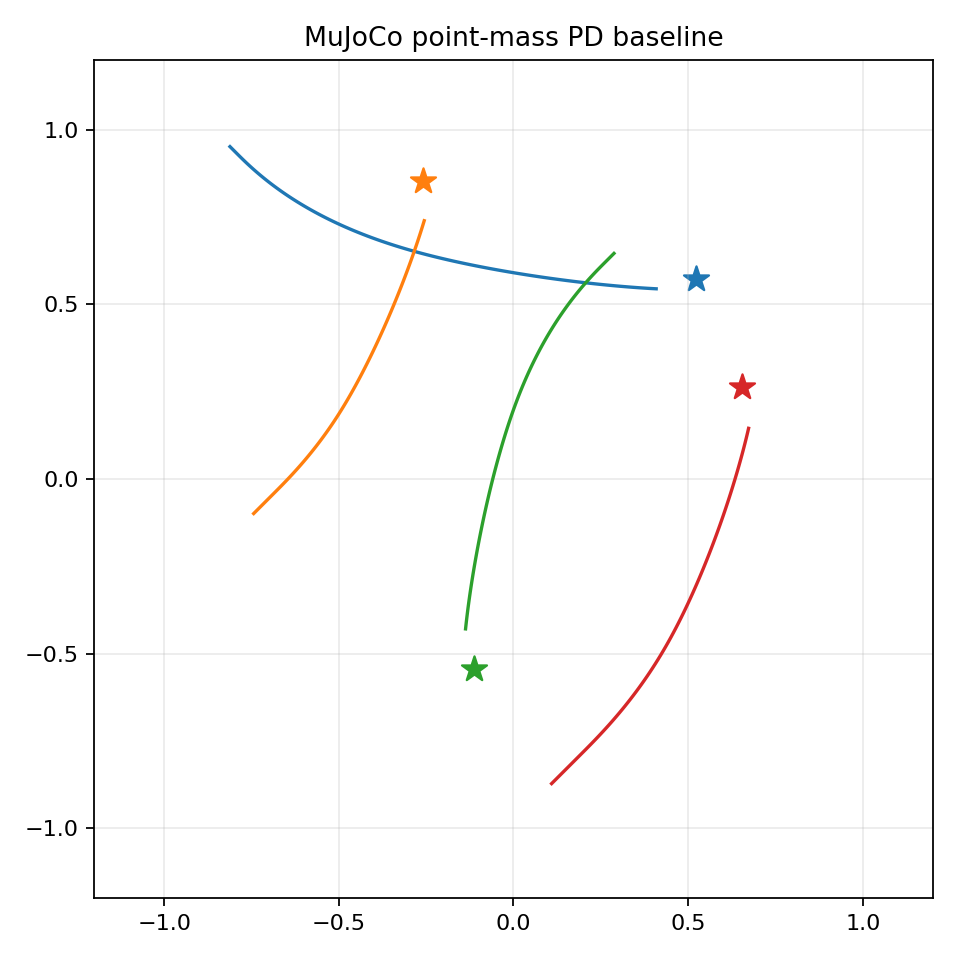
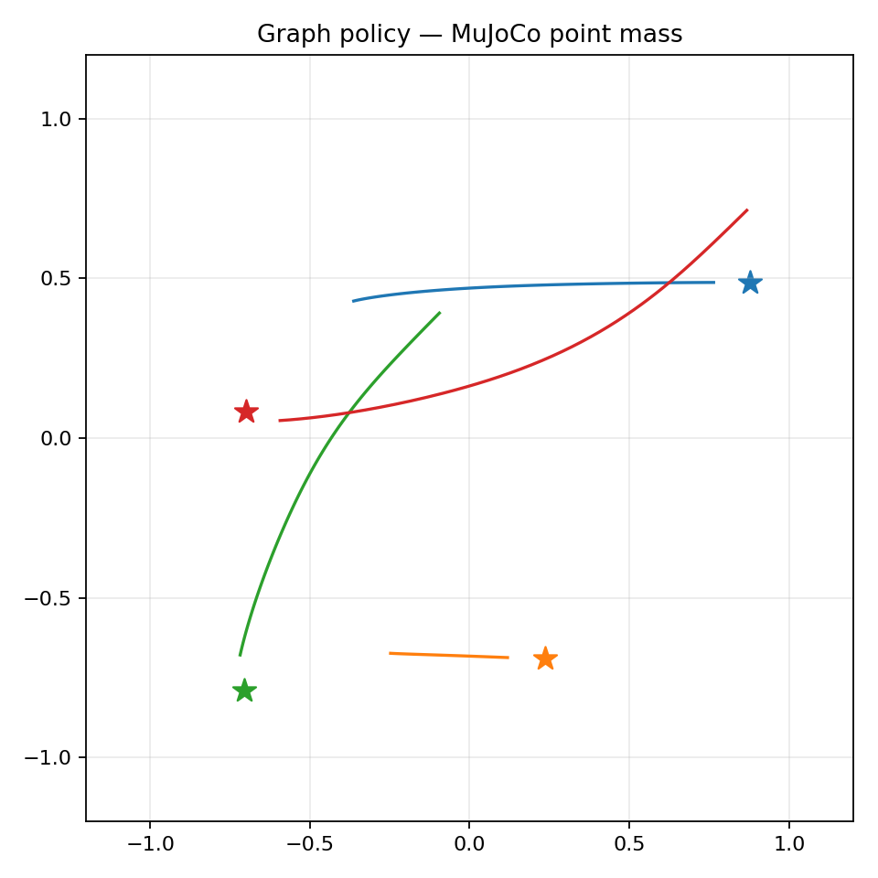

# Embodied Simulation — MuJoCo Point Mass

> **Current active focus.**
> Non-embodied work is archived in `archive/`; see `CURRENT_FOCUS.md`.

## 状态

已安装并跑通：

- MuJoCo 3.2.7
- glfw 2.11.0
- Python 3.10 / Windows
- CPU，无渲染窗口依赖

没有安装 Gymnasium / PyBullet：当前主机访问 PyPI 的 TLS 被拦截，已通过本地 wheel 安装 MuJoCo。

wheel 目录：

```text
wheels/mujoco-3.2.7-cp310-cp310-win_amd64.whl
wheels/glfw-2.11.0-py2.py3-none-win_amd64.whl
```

---

## 第一个任务：2D 点质量到达目标

文件：

- point_mass_env.py
- run_pd.py

观察：

```text
[x, y, vx, vy, target_x, target_y]
```

动作：

```text
[fx, fy]，范围 [-1, 1]
```

奖励：

```text
-distance(agent, target)
```

成功：

```text
distance < 0.12
```

最大步数：

```text
250
```

---

## 运行 PD 基线

```powershell
cd "C:\Users\MENG XAINGZE\Desktop\DEMO"

.\silicon_env\Scripts\python.exe embodied_sim\run_pd.py
```

结果：

```text
success_rate = 1.0
mean_steps = 94.64
mean_return = -66.3961
```

轨迹图：



---

## 图控制器（已接入）

文件：

- graph_policy.py
- train_graph_policy.py

结构：

```text
obs (6)
→ 500 节点图
→ K = 6 步消息传递
→ h[2:] → policy head → action (2)
```

方法：

```text
PD 专家 → 行为克隆 → DAgger
```

结果：

```text
BC：success 1.00，101.27 steps
DAgger 1：1.00，93.03 steps
DAgger 2：1.00，95.90 steps
最终 50 episodes：1.00，95.68 steps
```

运行：

```powershell
.\silicon_env\Scripts\python.exe embodied_sim\train_graph_policy.py
```



注意：

> 这是模仿 PD 的行为克隆 + DAgger，不是从奖励中自己发现策略。

---

## 增加障碍测试：1→2→3

- I 模型 1150 节点
- 1/2/3 障碍，100 episodes
- shield 0.30

结果：

```text
1 障碍：0.88 / shield 1.00
2 障碍：0.89 / shield 0.95
3 障碍：0.74 / shield 0.81
```

结论：

> 1→2 基本延续，2→3 明显下降；4 个以上障碍当前观测不到。

详见：

- OBSTACLE_SCALING_REPORT.md

---

## J：I 模型安全层阈值消融（89% → 92%）

- I 模型基线 89%
- 阈值 0.30 最优 92%
- 阈值 0.45 触发过多掉到 85%

详见：

- SAFETY_THRESHOLD_I_REPORT.md

---

## I 收口：gated local subgraph（85.67% → 89.67%）

- 基座：2 障碍 +100
- 新节点只接旧 hidden，不扩 head
- gate 0.5
- 阈值 0.0001
- 3 轮 × 50
- 3 seeds

结果：

```text
base ≈ 0.8567
best ≈ 0.8967
final ≈ 0.8767
```

详见：

- GATED_LOCAL_FINAL_REPORT.md

---

## J 初版：2 障碍安全层（82% → 91%）

- 2 障碍 +100 基线
- 障碍距离 < 0.45 时专家接管
- 100 episodes

结果：

```text
baseline：0.82
shield：  0.91
```

详见：

- SAFETY_2OBS_REPORT.md

---

## F/G/H 高级消融：时间输入 / 调度 / 半衰期

- 2 障碍，500 节点
- F 时间输入：0.72
- G 时间调度：0.72
- H 半衰期 0.05/0.10/0.25：全部剪枝后 0.36

结论：

> 时间输入、时间调度、半衰期都没有差异；剪枝有害。

详见：

- ADVANCED_FGH_REPORT.md

---

## 主基线：2 障碍 +100 / 3 障碍 +100

- 2 障碍：500 → 1000，84%
- 3 障碍：500 → 1000，93%

checkpoint：

```text
mzx_2obs_plus100.pt
mzx_3obs_plus100.pt
```

详见：

- MAIN_BASELINES_REPORT.md

---

## 2 障碍单独训练 + 生长（最优 +100）

- 基座：2 障碍 BC 85%
- 生长：每轮 +50 / +100 / +150
- 3 seeds

结果：

```text
baseline：0.8567
+50：   0.8633
+100：  0.8733
+150：  0.8700
```

结论：

> 2 障碍自己的最优是每轮 +100，87.33%。

详见：

- GROWTH_2OBS_DIRECT_REPORT.md

---

## 3 seeds 细扫 + 2 障碍单独训练

3 seeds 细扫：

```text
3 固定最优：+50/+100 → 0.86
2 随机最优：+150 → 0.4233
2 随机方差：0.26–0.47
```

2 障碍单独训练：

```text
BC 0.84 → DAgger 0.85
```

结论：

> 2 障碍单独训练 85%，zero-shot 只有 35–48%，分布匹配比生长更关键。

详见：

- GROWTH_SCALE_3SEEDS_REPORT.md
- BC_2OBS_DIRECT_REPORT.md

---

## 生长数量级 sweep + MuJoCo 2 障碍（有影响）

3 固定障碍 BC 86% → 生长 → 2 随机障碍测试。

结果：

```text
总生长 +0：   3固定 0.78 / 2随机 0.35
总生长 +100： 3固定 0.82 / 2随机 0.48
总生长 +250： 3固定 0.84 / 2随机 0.47
总生长 +500： 3固定 0.80 / 2随机 0.40
总生长 +1000：3固定 0.88 / 2随机 0.41
总生长 +2000：3固定 0.61 / 2随机 0.31
```

结论：

> 生长数有影响，呈倒 U 形；最优 +100 到 +250。

详见：

- GROWTH_SCALE_MUJOCO_REPORT.md

---

## 3 障碍 BC 86% + 生长数 sweep（无提升）

- 3 固定障碍
- BC 86%
- gate 可学习 0.5
- 阈值 0.0001
- 高误差区域
- 生长数 0/5/10/20/40

结果：

```text
0：0.85–0.89
5：0.81–0.86
10：0.81–0.85
20：0.81–0.85
40：0.85
```

结论：

> 生长数不是关键变量；新节点仍没带来增益。

详见：

- GROWTH_SWEEP_3OBS_REPORT.md

---

## G1–G4：gate / local subgraph / 3 固定障碍（无提升）

500 节点、3 固定障碍、3 seeds。

结果：

```text
base 0.49
G1 output 0.5067
G2 local  0.5067
G3 gated  0.5067
```

结论：

> 贡献验收生效：G1/G3 被拒绝，G2 接受生长，但最终能力不变。

详见：

- GATED_GROWTH_REPORT.md

---

## 核心消融 A–E（生长没有贡献）

500 节点、2 障碍、3 seeds。

结果：

```text
A 固定：0.8067
B 只生长：0.8067
C 只剪枝：0.7600
D 生长+剪枝：0.8067
E 加时间衰减：0.8067
```

结论：

> 生长没有提升，剪枝有害，时间衰减无差异。

详见：

- CORE_ABLATION_REPORT.md

---

## 触发式 DAgger + 安全盾（有效）

- 新任务：1 随机障碍 + 随机目标
- 模型迷茫时专家接管
- 动态安全盾

结果：

```text
BC baseline：0.48
Triggered DAgger：0.88
Safety shield：0.84
```

详见：

- TRIGGERED_DAGGER_REPORT.md

---

## 2000 节点 + 生长 v2（2 障碍、5 seeds）

- 2 障碍
- 生长 20/轮
- 4 轮
- 5 seeds
- 只训练新节点
- usage 阈值 0.02
- 验证回滚

结果：

```text
source ≈ 0.778
target ≈ 0.760
fixed3 ≈ 0.424
```

结论：

> 生长大多数被回滚，没有稳定超过 80%。

详见：

- MZX_GROWTH2_REPORT.md

---

## 2000 节点 + 生长 v3（3 障碍、5 seeds、回滚）

- 4 轮生长
- 20/轮
- 2000 → 2080
- 3 障碍
- 5 seeds
- 验证回滚
- 生命周期核心：mzx_lifecycle.py

结果：

```text
BC 58–76%
source ≈ 0.686
target ≈ 0.632
PPO 全部被门槛拦下
```

详见：

- MZX_GROWTH3_REPORT.md

---

## 2000 节点 + 生长逻辑（接回主线）

- 2000 → 2050 节点
- BC → DAgger → 5 轮生长/剪枝 → PPO
- 2 障碍，目标 ±0.6

结果：

```text
BC 0.88
after lifecycle 0.83
PPO final 0.88
source 0.88
target 0.76
alive 1988
```

详见：

- MZX_2000_GROWTH_REPORT.md

---

## 2000 节点 + 2 障碍 + 5 seeds（做稳）

- 2 障碍随机
- 目标 ±0.6
- BC 30 epochs
- BC ≥80% 才进 PPO
- 5 seeds
- 3 障碍固定位置 / 目标扩大做 zero-shot 测试

结果：

```text
source   ≈ 0.824
target   ≈ 0.762
target2  ≈ 0.700
fixed3   ≈ 0.474
CPU 0.2191 ms
```

详见：

- MZX_2OBS_5SEEDS_REPORT.md

---

## 2000 节点 + 3 障碍 + 5 seeds + 强 sim-to-sim

- 2000 节点
- 3 障碍
- 目标 ±0.9
- 5 seeds
- target domain：观测噪声 0.05 + 阻尼 0.6
- CPU batch1 延迟：0.2234 ms

结果：

```text
source ≈ 0.596
target ≈ 0.548
```

结论：

> 3 障碍 + 大目标超出当前能力；延迟不是问题。

详见：

- MZX_2000_FINAL_REPORT.md

---

## 2000 节点 + 2 障碍 + sim-to-sim（2 seeds）

- 2000 节点
- 2 障碍
- 目标 ±0.6
- source / target domain
- 2 seeds

结果：

```text
source ≈ 0.78
target ≈ 0.80
```

详见：

- MZX_2000_SIM2SIM_REPORT.md

---

## 目标随机 → 障碍随机，一次只改一个变量（成功）

Task A：固定障碍 + 随机目标

```text
专家 0.85 → BC 0.88 → PPO 0.90
```

Task B：随机障碍 + 同一目标

```text
专家 0.93 → BC 0.84 → DAgger 0.92 → PPO best 0.96
```

详见：

- TARGET_OBSTACLE_CURRICULUM_REPORT.md

---

## BC 99% → PPO 小范围随机（失败）

- BC 固定任务：0.99
- 小范围随机目标 + 1 随机障碍
- PPO best：0.47
- 强目标：0.03

结论：

> BC 99% 只适用于固定任务；换分布直接 PPO 不够，需要重新收集专家数据。

详见：

- BC_DAGGER_TO_PPO_REPORT.md

---

## PD 避障专家 + DAgger（BC 99%）

- PD 吸引力 + 障碍斥力
- 专家成功率 96%
- BC 40 epochs
- 评估 100 episodes
- DAgger 2 轮

结果：

```text
专家：0.96
BC：0.99
DAgger：0.98
```

结论：

> 之前 BC 只有 50%，是专家/任务设置问题，不是图容量。

详见：

- BC_DAGGER_REPORT.md

---

## BC 稳定性：固定初始化 + 5 seeds（未达 80%）

- 1 固定障碍 + 固定目标
- 同一图初始化
- 17,119 样本
- 12 epochs
- 5 seeds

结果：

```text
test mean = 0.508
test std  = 0.047
val 73–77%，test 48–60%
```

结论：

> 固定初始化降低方差，但 BC 能力本身只到约 50%；不能进 PPO。

详见：

- BC_STABLE_REPORT.md

---

## BC → PPO 扩展 v2：5 seeds、20 updates（失败/方差大）

- 障碍课程：fixed → small → medium
- 1 → 2 → 3 障碍
- 3 障碍额外再跑一轮
- 20 updates，early stop，best checkpoint

结果：

```text
3obs best 均值 0.456
只有 seed 32000 到 0.80
extra best 0.84（仅 seed 32000）
```

结论：

> 5 seeds 方差极大，当前瓶颈是 BC 初始化不稳定。

详见：

- BC_PPO_EXPAND_V2_REPORT.md

---

## BC → PPO 扩展：中等范围 1→2→3 障碍（3 seeds）

- small 1obs → medium 1obs → medium 2obs → medium 3obs
- 8 envs × 256 steps
- 10 updates / stage
- 验证 50 episodes
- best checkpoint + early stop
- 3 seeds

均值：

```text
small 1obs：best 0.927
medium 1obs：best 0.953
medium 2obs：best 0.900
medium 3obs：best 0.840
```

详见：

- BC_PPO_EXPAND_REPORT.md

---

## BC → PPO 课程：固定 → 小范围随机（成功）

- Stage A：固定目标 / 固定障碍
- Stage B：小范围随机目标 / 随机障碍
- 8 envs × 256 steps
- KL 0.20 → 0.02
- best checkpoint + early stop

结果：

```text
固定：BC 0.53 → PPO 0.77
小范围随机：BC 0.43 → PPO best 0.97
强随机：0.43
```

详见：

- BC_PPO_CURRICULUM_REPORT.md

---

## BC → PPO 固定目标小范围（PPO 提升）

- 1 个固定障碍
- 固定目标 (0.5, 0.0)
- 8 envs × 256 steps
- KL 0.20 → 0.02 退火
- best checkpoint + early stop

结果：

```text
BC：0.5333
PPO best：0.7667
强目标：0.1667
```

详见：

- BC_TO_PPO_FIXED_REPORT.md

---

## BC 93% → PPO 微调 v2（不坍缩，但没提升）

- KL 0.2
- BC 0.3
- 30 episodes 验证
- 连续 2 次不提升早停
- best checkpoint

结果：

```text
BC：0.9333
PPO update 0：0.8667
PPO update 5：0.9333
early stop
最终保留 BC
```

详见：

- BC_TO_PPO_V2_REPORT.md

---

## BC 93% → PPO 微调（best checkpoint 90%）

- 从 BC checkpoint 开始
- PPO + KL/BC anchor
- 确定性评估
- 2 个随机障碍

结果：

```text
BC：0.9333
PPO 最后：0.5000
PPO best：0.9000（update 5）
```

结论：

> PPO 仍会过训练坍缩，必须用 best checkpoint / early stopping。

详见：

- BC_TO_PPO_REPORT.md

---

## 连续 PPO：replay + KL + optimizer checkpoint（失败）

- 6 个冲突阶段
- PPO 替代 BC
- replay 4000
- KL 到旧策略
- optimizer state 保存/加载

结果：

```text
stage0：0.05
stage1：0.35
后面：0–5%
```

结论：

> PPO 从零连续训练失败；replay/KL 无法替代 BC 初始化。

详见：

- CONTINUAL_PPO_REPORT.md

---

## 连续训练：checkpoint 接续（成功）

- stage0：无障碍
- stage1：1 固定障碍
- stage2：2 随机障碍
- 每阶段加载上一轮 checkpoint
- 保存 mzx_stage*.pt

结果：

```text
连续：1.00 / 0.90 / 0.95
从零：1.00 / 0.65 / 0.90
最终回测：1.00 / 0.95 / 0.90
```

详见：

- CONTINUAL_LEARNING_REPORT.md
- continual_learning.py

---

## 生命周期 + PPO + 2 障碍

- 2 个随机障碍
- 目标 ±1.0
- PPO 20 updates
- 4 并行环境

结果：

```text
PPO 前：0.25
PPO 后：0.30
target：0.20
```

结论：

> 2 障碍这次没有变差，但提升很小。

详见：

- LIFECYCLE_PPO_2OBSTACLES_REPORT.md

---

## 生命周期 + PPO + 3 障碍（失败）

- MZX-0.1 生命周期：500 → 550 节点
- PPO 微调
- 3 个随机障碍
- 目标随机化 ±1.2

结果：

```text
1 随机障碍：0.20
3 随机障碍：0.10
target：0.25
```

详见：

- LIFECYCLE_PPO_OBSTACLES_REPORT.md

---

## 具身生命周期 v2：Stage 1 单障碍

- tau 8.0
- usage 0.005
- 3 epoch/轮
- 生长 10/轮
- 5 轮
- 500 → 550 节点

结果：

```text
success 0.65–0.70
生长 50，剪掉 34
alive ≈ 516
```

详见：

- lifecycle_embodied_v2.py
- LIFECYCLE_EMBODIED_V2_REPORT.md

---

## 具身生命周期：训练 → 生长 → 反传 → 遗忘剪枝

已实现于：

- lifecycle_embodied.py

结果：

```text
500 → 600 节点
success 始终 1.00
只剪掉 1 个节点
```

结论：

> 机制跑通，点质量任务没崩；但遗忘曲线衰减太快，剪枝太保守。

详见：

- LIFECYCLE_EMBODIED_REPORT.md

---

## 单一变量：生长 200 节点（失败）

在课程 v2 的 BC 后加入 200 节点生长。

结果：

```text
Stage 0 生长前 = 0.9667
Stage 0 生长后 = 0.1000
Stage 1 PPO    = 0.0333
Target         = 0.0333
```

结论：

> 当前“BC 后直接生长”是破坏性的，不是因为生长一定有害。

详见：

- GROWTH_SINGLE_VARIABLE_REPORT.md

---

## 课程 v2：20k BC + 64 视觉 + 单障碍（Stage0 成功）

- BC 数据 20,000
- BC 30 epochs
- 64×64 视觉
- 4 并行环境
- Stage 0：无障碍小范围
- Stage 1：1 个固定障碍物
- per-env GAE

结果：

```text
Stage 0 BC success = 0.9667
Stage 1 PPO success = 0.0333
Target domain       = 0.00
```

详见：

- CURRICULUM_VISION_V2_REPORT.md

---

## 课程 + 视觉 BC + PPO（管道跑通，成功率低）

- 32×32 视觉
- 2000 节点图
- 4 个并行环境
- Stage 0：无障碍、小范围
- Stage 1：2 个障碍物
- PD 视觉演示 → BC → PPO

结果：

```text
BC stage0     = 0.40
PPO stage1    = 0.05
target domain = 0.00
```

详见：

- curriculum_vision.py
- CURRICULUM_VISION_REPORT.md

---

## 视觉 + 2000 节点 + sim-to-sim（失败）

已加：

- MuJoCo top camera，64×64×3
- CNN → 64 维 latent
- 2000 节点图，K=6
- source / target 两个视觉/物理域

结果：

```text
source success = 0.00
target success = 0.00
```

结论：

> 视觉和 sim-to-sim 流程跑通，但 PPO 从零学习失败。

详见：

- VISION_2000_SIM2SIM_REPORT.md
- vision_samples.png

---

## PPO + 障碍物（失败）

已加：

- 3 个圆形障碍物
- 起点随机 [-1.3, 1.3]
- 目标随机 [-1.6, 1.6]
- 障碍物随机
- PPO，500 节点图，K=6

结果：

```text
final success = 0.04
mean steps = 247.08
```

结论：

> 当前 PPO 配置在强随机化 + 障碍物下基本学不会。

详见：

- PPO_OBSTACLES_REPORT.md
- ppo_graph_obstacles.png

---

## 下一阶段

1. 课程学习：先无障碍、小范围
2. 加奖励塑形
3. 更多并行环境
4. CEM / ES 作为对照
5. 2000 节点图替换 500 节点
6. 真机前先做 sim-to-sim

---

## 注意

- 当前是点质量，不是完整机器人。
- MuJoCo 可以无窗口运行。
- 若要开 viewer，需要桌面图形环境。
- 下一步先在仿真里训练图控制器，不要直接上真机。
