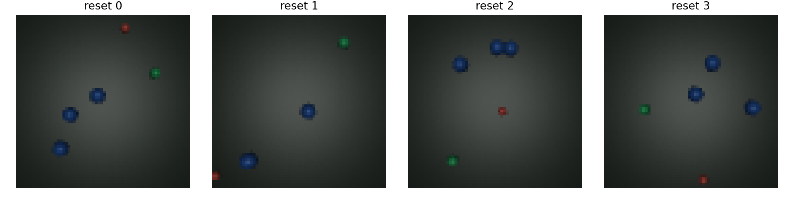

# 视觉 + 2000 节点图 + sim-to-sim

日期：2026-11-22  
环境：MuJoCo point mass + obstacles + top-down camera  
方法：视觉 CNN + 2000 节点图 actor-critic + PPO  

---

## 1. 视觉输入

- MuJoCo camera: top
- 64×64×3 RGB
- 附带 12 维状态

示例：

---

## 2. 模型

~~~text
image 64×64×3
→ CNN → 64 维 latent
→ 2000 节点图 (K=6)
→ h[2:] + state(12)
→ actor / critic
~~~

动作 2 维。

---

## 3. sim-to-sim

### source

- 原始障碍物颜色
- 原始阻尼
- 目标范围 ±1.6

### target

- 障碍物颜色改变
- 阻尼 1.2 → 0.8
- 目标范围扩大 1.2 倍

---

## 4. 训练

~~~text
PPO
20 updates × 1024 steps
500 → 2000 节点
无 PD 专家
~~~

---

## 5. 结果

| domain | success | mean steps |
| --- | ---: | ---: |
| source | 0.00 | 250.0 |
| target | 0.00 | 250.0 |

训练过程中偶尔 target 到 0.2，但最终都回到 0。

---

## 6. 结论

> 视觉和 2000 节点图已经接上，sim-to-sim 流程也跑通了，但 PPO 从零学习失败。

原因：

- 视觉 + 障碍物 + 强随机化，任务太难
- 20 updates 太少
- 没有课程学习
- 没有专家演示
- 单环境采样效率低
- 2000 节点图 + K=6 仍然没有足够结构

---

## 7. 重要说明

这次不能说明“视觉没用”或“sim-to-sim 失败”。

只说明：

> 当前训练配置不足以从零学会这个任务。

---

## 8. 下一步

1. 课程学习：先无障碍、小范围
2. 用 PD 演示做视觉行为克隆
3. 再加 PPO 微调
4. 并行环境
5. 简化障碍物
6. 视觉分辨率先降到 32×32

---

## 9. 一句话

> 视觉输入、2000 节点图、sim-to-sim 都已经接好；但零样本 PPO 训练失败，下一步应先课程学习或演示学习。

---

## 10. 文件

- vision_env.py
- vision_graph_ppo.py
- vision_graph_ppo_result.json
- vision_samples.png
- VISION_2000_SIM2SIM_REPORT.md
