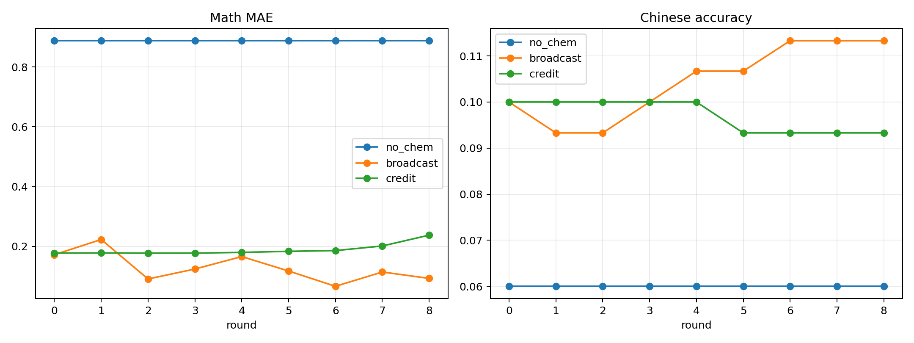

# 化学信号分配对照实验：no chem vs broadcast vs credit

日期：2026-11-20  
图：2000 节点 / 9022 边；8 轮静态训练；数学 + 真实中文。

---

## 1. 三种模式

### no_chem

- 无化学 gain
- gain = 1
- 边权不更新

### broadcast

- 当前旧实现
- 正/负反馈广播到所有节点
- 所有边参与权重更新

### credit

- 用 readout 的误差梯度 × 特征，算每个节点 credit
- 只取 top-20 正贡献 / top-20 负贡献节点释放化学
- 边按 `credit_v * act_u` 更新

---

## 2. 结果

| 模式 | 数学初始 | 数学最终 | 中文初始 | 中文最终 | 活跃边初始 | 活跃边最终 |
| --- | ---: | ---: | ---: | ---: | ---: | ---: |
| no_chem | 0.88766 | 0.88766 | 0.0600 | 0.0600 | 9022 | 9022 |
| broadcast | 0.17194 | **0.09272** | 0.1000 | **0.1133** | 7672 | 8664 |
| credit | 0.17754 | 0.23742 | 0.1000 | 0.0933 | 7739 | 7725 |

---

## 3. 结论

> 这次 credit 分配没有改善，反而比 broadcast 差。

数学：

~~~text
broadcast 0.09272
credit    0.23742
~~~

中文：

~~~text
broadcast 0.1133
credit    0.0933
~~~

---

## 4. 为什么 credit 失败

### 4.1 太稀疏

只给 top-20 节点释放化学，大部分节点完全没有信号。

### 4.2 credit 噪声大

readout 是 1998 维、300 训练样本，系数本身不稳定。

单样本 top-k credit 在样本之间变化很大，  
平均后互相抵消。

### 4.3 边 credit 太小

~~~text
edge_credit = credit_v * act_u
~~~

大部分值很小，权重几乎不变。

### 4.4 活跃边没有形成修剪

credit 模式：

~~~text
7739 -> 7725
~~~

几乎不变。

broadcast 模式：

~~~text
7672 -> 8664
~~~

边反而越来越多。

---

## 5. 一个反直觉结果

no_chem 的数学 MAE 是 0.8877，比 broadcast 和 credit 都差很多。

原因是 no_chem 没有化学 gate，所有边全开，特征分布不同。

所以这不是“化学无效”，而是：

> 化学 gate 本身改变了图的特征尺度，  
> 但“如何分配化学”还没有找到正确方式。

---

## 6. 更重要的问题

广播反而更好，说明当前瓶颈不是“信号太扩散”，而是：

- 化学场提供的是一种全局 gain 调制
- 这种全局调制对数学有效
- 细粒度 credit 反而不稳定

所以 credit 不是天然更优。

---

## 7. 下一步

1. top-k 从 20 扩大到 100 / 200
2. 用 batch 平均 credit，而不是单样本 top-k
3. 加验证集决定是否接受本轮化学更新
4. 用完整反向传播算 credit，而不是 readout 代理
5. 对 credit 做 EMA 平滑

---

## 8. 一句话

> 按贡献度分配的化学信号这次没有起作用；broadcast 反而更好。  
> 说明“更精细的 credit”不等于“更有效的化学调制”，当前 readout credit 太噪声。

---

## 9. 文件

- credit_chem_ablation.py
- credit_chem_ablation_result.json
- credit_chem_ablation.png
- CREDIT_CHEM_ABLATION_REPORT.md
