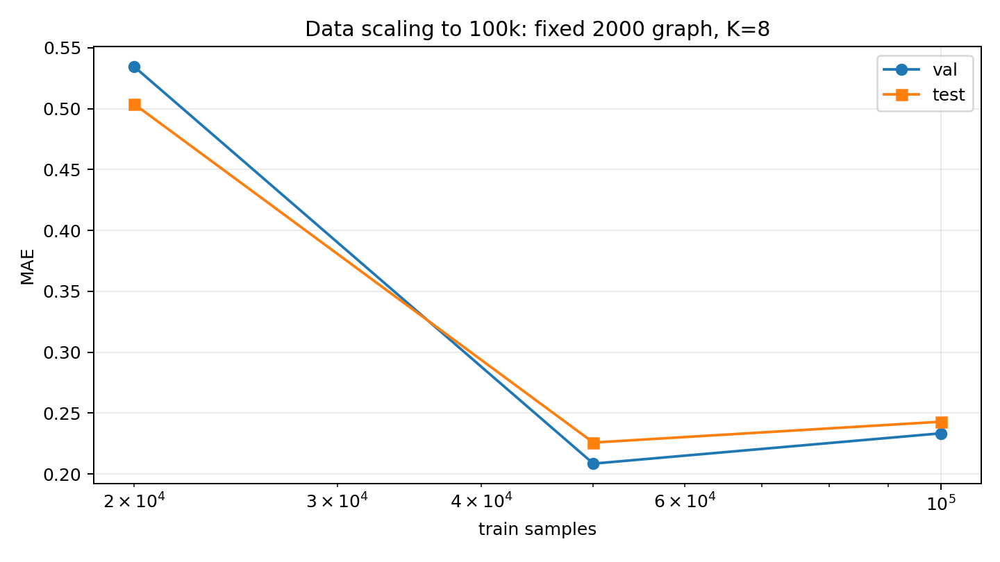

# 数据扩张到 100k：固定 2000 图，K=8

日期：2026-11-20  
目的：只增加训练数据，看是否继续下降。

---

## 1. 设置

~~~text
固定 2000 节点
9022 边
K = 8
8 epoch
batch = 64
训练量：20k / 50k / 100k
验证：500
测试：1000
单 seed：2181
~~~

---

## 2. 结果

| train size | val MAE | test MAE | 时间 |
| ---: | ---: | ---: | ---: |
| 20000 | 0.53467 | 0.50394 | 32.513 s |
| 50000 | **0.20849** | **0.22580** | 85.443 s |
| 100000 | 0.23338 | 0.24292 | 163.466 s |

---

## 3. 结论

> 数据在 50k 左右饱和。

~~~text
20k：0.504
50k：0.226
100k：0.243
~~~

从 50k 到 100k：

- 数据翻倍
- 时间翻倍
- test MAE 没有下降，反而略升

所以：

> 继续加数据，收益已经很小。

---

## 4. 这说明什么

- 20k → 50k 有明显收益
- 50k 后进入平台
- 当前瓶颈不是数据量
- 更可能是：
  - K=8 太浅
  - 2000 节点随机图表达不足
  - 优化/正则化
  - 单 seed 方差

---

## 5. 效率

~~~text
总耗时：282.228 s
20k：32.5 s
50k：85.4 s
100k：163.5 s
~~~

---

## 6. 下一步

1. 在 50k 上跑 3 seeds
2. 加 K=12 / 16
3. 加 fixed vs grow 对照
4. 不再盲目加数据

---

## 7. 一句话

> 数据到 50k 左右饱和；20k→50k 有明显提升，50k→100k 没有。下一步该加深度/结构，而不是继续加数据。

---

## 8. 文件

- data_scaling_more.py
- data_scaling_more_result.json
- data_scaling_more.png
- DATA_SCALING_MORE_REPORT.md
