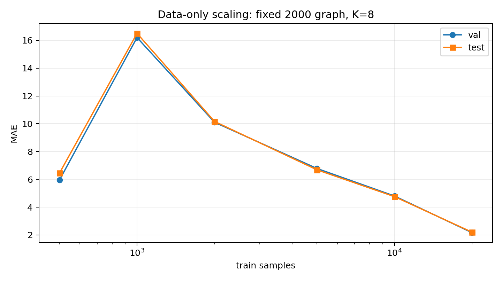

# 只扩张数据量：2000 固定图，K=8

日期：2026-11-20  
目的：不生长、不改架构，只增加训练样本。

---

## 1. 设置

~~~text
固定 2000 节点
9022 边
K = 8
8 epoch
batch = 64
训练量：500 / 1000 / 2000 / 5000 / 10000 / 20000
验证：500
测试：1000
~~~

---

## 2. 结果

| train size | val MAE | test MAE | 时间 |
| ---: | ---: | ---: | ---: |
| 500 | 5.96509 | 6.45772 | 2.114 s |
| 1000 | 16.20140 | 16.50223 | 1.770 s |
| 2000 | 10.10737 | 10.16485 | 3.248 s |
| 5000 | 6.78185 | 6.68573 | 7.883 s |
| 10000 | 4.80232 | 4.75856 | 15.649 s |
| 20000 | **2.16762** | **2.20306** | 31.244 s |

---

## 3. 结论

### 有作用

从 500 → 20000：

~~~text
6.46 → 2.20
~~~

整体下降。

### 不单调

中间出现异常：

~~~text
500：6.46
1000：16.50
2000：10.16
~~~

说明：

- 小数据时优化不稳定
- seed 影响很大
- 不是“数据越多一定越好”

---

## 4. 和数据量有关吗

部分有关。

到 10k / 20k 后确实更好，但：

- 20k 仍然只有 2.20
- 单次实验
- 没有多 seed
- 没有 early stopping
- 没有和 growth 版本公平比较

所以：

> 数据量是因素之一，但不是唯一瓶颈。

---

## 5. 效率

~~~text
总耗时：62.117 s
最大 20k 训练：31.244 s
~~~

---

## 6. 下一步

1. 在 20k 上跑 3 seeds
2. 看 50k / 100k 是否继续下降
3. 加 fixed vs grow 对照
4. 加 early stopping

---

## 7. 一句话

> 只扩数据能把 test MAE 从 6.46 降到 2.20，但不是单调下降；数据有帮助，单靠数据还不够。

---

## 8. 文件

- data_scaling_only.py
- data_scaling_only_result.json
- data_scaling_only.png
- DATA_SCALING_ONLY_REPORT.md
