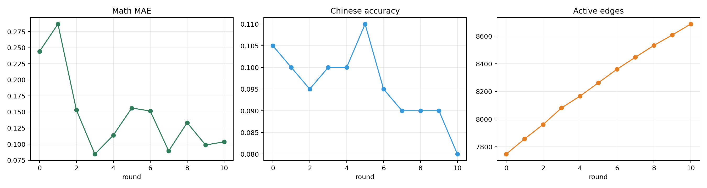

# 动态化学门控 + 边权更新实验

日期：2026-11-20  
范围：2000 节点 PoC；数学 + 真实中文；无时间递归，按训练轮动态更新。

---

## 1. 机制

化学场作为边的门控：

~~~text
gate_i = sigmoid(2.5 * (exc_i - inh_i - 0.35))
w_eff_ij = w_ij * (0.2 + 1.4 * gate_i * gate_j)
~~~

只有：

~~~text
w_eff_ij > 0.08
~~~

这条边才处于活跃状态。

反馈更新：

~~~text
w_ij += 0.020 * fb * act_i * act_j - 0.010 * (w_ij - w0_ij)
~~~

- 数学：按本批误差中位数，低于中位数为正反馈，高于为负反馈
- 中文：预测正确 +1，错误 -1

化学源：

- 正反馈 -> DA / Glu
- 负反馈 -> NE / GABA

不是时间步；一轮训练 = 一次动态更新。

---

## 2. 日志

~~~text
ROUND 0  math_mae=0.24422 chinese_acc=0.105 active_edges=7747 mean_w=0.1521
ROUND 1  math_mae=0.28690 chinese_acc=0.100 active_edges=7857 mean_w=0.1569
ROUND 2  math_mae=0.15310 chinese_acc=0.095 active_edges=7961 mean_w=0.1620
ROUND 3  math_mae=0.08448 chinese_acc=0.100 active_edges=8081 mean_w=0.1669
ROUND 4  math_mae=0.11391 chinese_acc=0.100 active_edges=8166 mean_w=0.1722
ROUND 5  math_mae=0.15623 chinese_acc=0.110 active_edges=8263 mean_w=0.1777
ROUND 6  math_mae=0.15157 chinese_acc=0.095 active_edges=8360 mean_w=0.1835
ROUND 7  math_mae=0.08940 chinese_acc=0.090 active_edges=8447 mean_w=0.1896
ROUND 8  math_mae=0.13335 chinese_acc=0.090 active_edges=8532 mean_w=0.1953
ROUND 9  math_mae=0.09863 chinese_acc=0.090 active_edges=8608 mean_w=0.2012
ROUND 10 math_mae=0.10360 chinese_acc=0.080 active_edges=8687 mean_w=0.2076
~~~

---

## 3. 结果

| 指标 | 初始 | 最终 | 最好 |
| --- | ---: | ---: | ---: |
| 数学 MAE | 0.24422 | 0.10360 | **0.08448** |
| 中文 acc | 0.1050 | 0.0800 | 0.1100 |
| 活跃边 | 7747 | 8687 | — |
| 平均权重 | 0.1521 | 0.2076 | — |

---

## 4. 结论

### 数学

- 最终 MAE 0.1036
- 最好 0.0845
- 比初始 0.2442 明显改善
- 但波动较大

### 中文

- 初始 0.105
- 最终 0.080
- 没有改善，反而下降

### 边连接/断开

一开始有 1275 条边低于阈值，处于关闭状态。

但后续：

~~~text
7747 -> 8687
~~~

活跃边数量持续上升，没有出现明显“断开”过程。

原因：

- 正反馈仍然占主导
- 化学 gate 平均值从 0.315 升到 0.426
- `w_eff` 整体变大

所以当前实现的“断开”主要是初始阈值造成的，不是持续动态修剪。

---

## 5. 重要限制

- 只跑了一次，没有多 seed
- 没有严格验证集早停
- 数学反馈用中位数，比较粗糙
- 中文反馈是二值正确/错误，信号很稀疏
- 活跃边持续增加，没有真正形成“用进废退”的稳定结构
- 不是时间递归，只是训练轮动态

---

## 6. 下一步

1. 加入 **负反馈更强的边衰减**
2. 设置每个节点的最大 degree
3. 允许被剪边在化学浓度高时重新激活
4. 用验证集决定是否保留本轮拓扑更新
5. 中文使用更强的语义特征，而不是字符 hash

---

## 7. 文件

- dynamic_chem_edges.py
- dynamic_chem_edges_result.json
- dynamic_chem_edges.png
- DYNAMIC_CHEM_EDGES_REPORT.md
