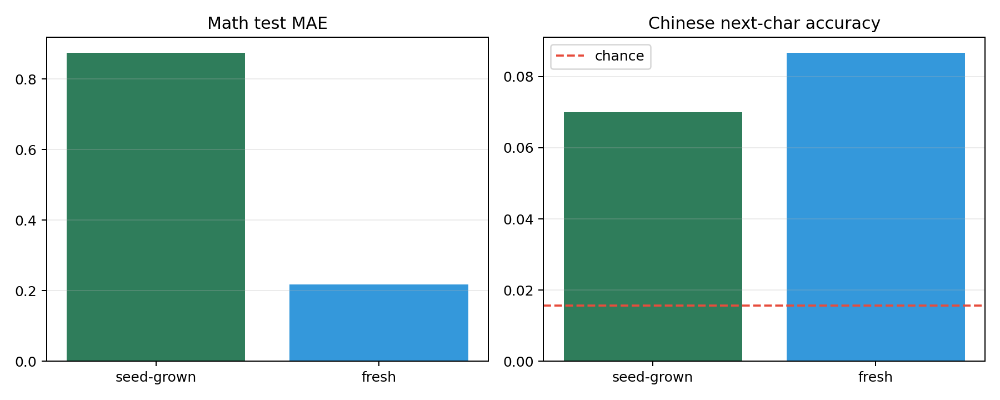

# Fair 10k comparison: seed-grown vs fresh

日期：2026-11-20  
目的：控制节点数、边数、output 入度、数据、readout 和模型随机种子后，比较 seed-grown 与 fresh。

---

## 1. 控制变量

两个图都是：

~~~text
节点：10000
边：56212
output：9999
output indegree：8002
~~~

相同：

- 数学数据
- 中文 Lu Xun next-character 数据
- 400/200 数学训练/测试
- 600/300 中文训练/测试
- input_gain 维度 64
- 化学场
- ridge readout
- bias/input_gain 随机种子：777

不同：

- 一个从 2000 seed 长出来
- 一个从零独立生成

---

## 2. 结果

| 模型 | 节点 | 边 | output indegree | 数学 MAE | 中文 acc |
| --- | ---: | ---: | ---: | ---: | ---: |
| seed-grown | 10000 | 56212 | 8002 | 0.87411 | 0.0700 |
| fresh | 10000 | 56212 | 8002 | **0.21827** | **0.0867** |

---

## 3. 结论

> 在控制变量后，fresh 反而更好。

- 数学：0.87411 → 0.21827，fresh 明显更好
- 中文：0.0700 → 0.0867，fresh 略好
- 中文差异只有 5 个测试样本（21/300 → 26/300），不能过度解释

这说明之前的结论：

~~~text
fresh 更差
~~~

主要是被这些因素混淆了：

- output 入度不同
- 边数不同
- 随机图不同
- 训练数据/模型随机种子不同

---

## 4. 重要限制

构造公平边预算时，为了让边数达到 56212，加入了额外 skip edges；  
同时 output 直连边导致最大边距离变大：

~~~text
seed-grown max edge distance = 98.69
fresh      max edge distance = 116.469
~~~

所以：

> 这不是严格的空间约束实验。  
> output 边被当作全局汇聚边，允许超过 30。

---

## 5. 中文仍然很弱

fresh 中文 8.67%，随机水平：

~~~text
1 / 64 = 1.56%
~~~

虽然高于随机，但绝对水平仍然很低。

结论：

> fresh 更好，但中文仍然没有形成真正的语言能力。

---

## 6. 耗时

~~~text
167.173 s
~~~

两次 10k 图的特征提取 + readout 训练。

---

## 7. 一句话

> 在控制节点数、边数、output 入度和随机种子后，fresh 10k 的数学反而明显好于 seed-grown 10k；之前“fresh 更差”的结论是混杂因素导致的。

---

## 8. 文件

- fair_10k_compare.py
- fair_10k_result.json
- fair_10k_compare.png
- FAIR_10K_REPORT.md
