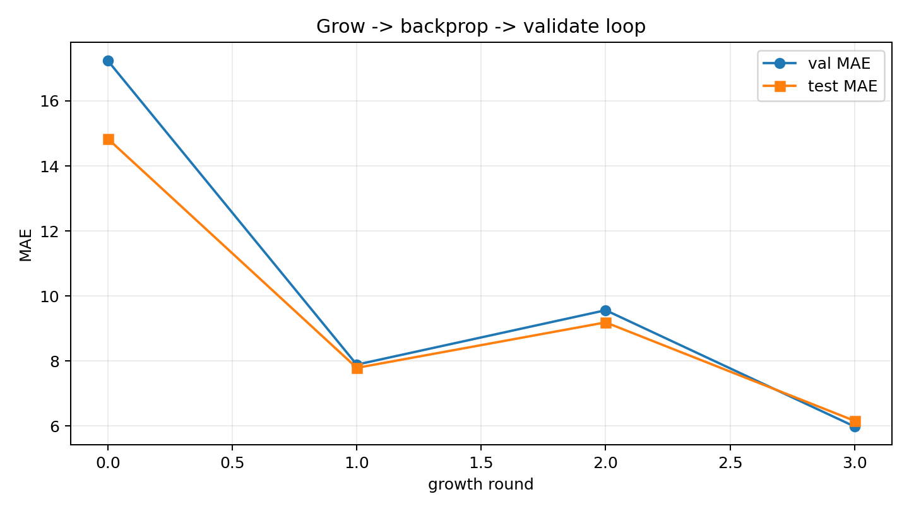

# 生长 → 反传 → 验证 → 再生长：第一次跑通

日期：2026-11-20  
图：2000 → 2060 节点  
训练：K=4 step 可微消息传递 + 全图反传  
任务：math sum_sq

---

## 1. 结构

~~~text
2000 节点
9022 边
K = 4 步消息传递
每轮生长 +20 节点
3 轮生长
700 训练 / 100 验证 / 100 测试
4 epoch / 轮
~~~

生长方式：

- 用验证集高误差样本
- 取该样本 top-4 活跃节点
- 新节点接这些前驱
- 新节点接到新 output
- 旧 output 变成 hidden relay

所有边权 / bias / input_gain / readout 都反传训练。

---

## 2. 日志

| round | nodes | edges | val MAE | test MAE |
| ---: | ---: | ---: | ---: | ---: |
| 0 | 2000 | 9022 | 17.23748 | 14.83809 |
| 1 | 2020 | 9118 | **7.89074** | 7.79137 |
| 2 | 2040 | 9214 | 9.56409 | 9.19002 |
| 3 | 2060 | 9310 | **5.98731** | **6.16287** |

---

## 3. 结果

- 第一轮生长后明显下降
- 第二轮过拟合/回退
- 第三轮继续下降
- 最终 test MAE 6.16287

结论：

> 循环机制跑通了：生长后可以反传训练，验证可以接受/回退。

但：

> 绝对精度仍然很差，6.16 MAE 对 sum_sq 不可用。

---

## 4. 重要说明

这次不是 2000 深度 DAG 的全图 BPTT。

用的是：

~~~text
K = 4 步同步消息传递
~~~

即：

~~~text
h^(0) = input
h^(k+1) = tanh(bias + input_gain*x + W h^(k))
~~~

所以它是：

> **固定 K 步、可反传的图网络**

不是完整 2000 层时序反传。

---

## 5. 为什么精度差

- K=4 太浅
- 2000 节点随机初始图
- 只有 700 训练样本
- 4 epoch 太少
- 生长节点初始化很弱
- 没有学习率调度
- 没有早停
- 没有 prune
- 任务目标未做 per-task 特征工程

---

## 6. 效率

~~~text
总耗时：2.685 s
4 个阶段
~~~

因为 K=4，不是 2000 深度循环。

---

## 7. 结论

> “生长 → 反传 → 验证 → 再生长”的循环是可运行的。  
> 但当前精度还不足以证明这种训练方式有效。

---

## 8. 下一步

1. K 提到 8 / 12
2. 训练样本加到 2000+
3. 每轮训练更多 epoch
4. 加早停和回滚
5. 加 prune，而不是只 grow
6. 用 validation 决定是否保留新节点
7. 比较 fixed 2000 vs grow 2000

---

## 9. 文件

- grow_train_loop.py
- grow_train_loop_result.json
- grow_train_loop.png
- GROW_TRAIN_LOOP_REPORT.md
