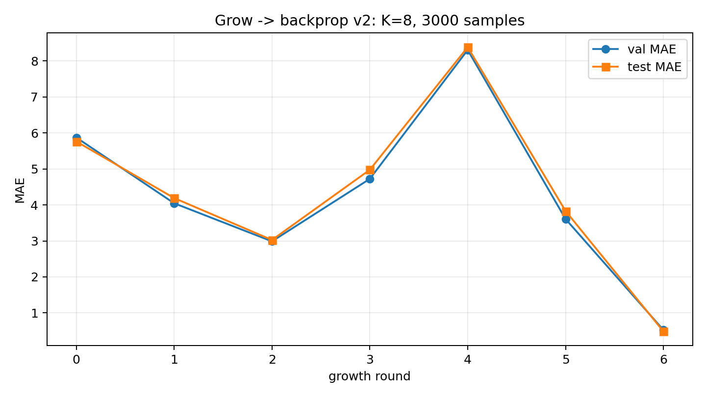

# 生长 + 反传 v2：K=8，3000 样本，6 轮生长

日期：2026-11-20  
图：2000 → 2300 节点  
任务：math sum_sq  
训练：2000 / 验证 500 / 测试 500

---

## 1. 配置

~~~text
初始节点：2000
每轮生长：+50
生长轮数：6
最终节点：2300
初始边：9022
最终边：10498
K = 8 步消息传递
每轮训练：8 epoch
batch = 64
~~~

---

## 2. 结果

| round | nodes | edges | val MAE | test MAE |
| ---: | ---: | ---: | ---: | ---: |
| 0 | 2000 | 9022 | 5.87206 | 5.76290 |
| 1 | 2050 | 9268 | 4.04619 | 4.19042 |
| 2 | 2100 | 9514 | 2.98821 | 3.02631 |
| 3 | 2150 | 9760 | 4.72326 | 4.97578 |
| 4 | 2200 | 10006 | 8.30368 | 8.38147 |
| 5 | 2250 | 10252 | 3.60901 | 3.83050 |
| 6 | 2300 | 10498 | **0.52731** | **0.48755** |

---

## 3. 结论

> 这一版从 test MAE 5.76 降到 0.488，提升约 11.8 倍。

但曲线非常不单调：

~~~text
5.76 → 4.19 → 3.03 → 4.98 → 8.38 → 3.83 → 0.49
~~~

所以：

- 生长确实能带来能力变化
- 但过程不稳定
- 最后一轮可能是特定 seed / 过拟合的结果

---

## 4. 训练 loss

最后一轮：

~~~text
train MSE = 0.00017
~~~

测试 MAE = 0.48755。

说明：

> 训练集已经几乎记住，测试集还有明显误差；有过拟合风险。

---

## 5. 效率

~~~text
总耗时：25.966 s
~~~

对比：

| 版本 | 节点 | K | 样本 | 时间 | test MAE |
| --- | ---: | ---: | ---: | ---: | ---: |
| v1 | 2060 | 4 | 700 | 2.685 s | 6.16287 |
| v2 | 2300 | 8 | 3000 | 25.966 s | **0.48755** |

---

## 6. 重要限制

- 只跑了一次，没有多 seed
- 没有独立验证早停
- 没有 prune
- 5 个测试点波动很大
- 最后一轮提升异常大，需要复现
- 仍然是 K=8，不是 2000 深度 DAG 全反传

---

## 7. 下一步

1. 用 3 个 seed 复现最后一轮
2. 加 prune，避免节点只增不减
3. 用独立验证集选最佳 round，而不是最后一轮
4. 扩到 10k 节点
5. 换一个任务验证泛化

---

## 8. 一句话

> v2 的 test MAE 降到 0.488，说明“生长 + 反传”值得继续；但曲线不稳定，最后一轮需要多 seed 复现。

---

## 9. 文件

- grow_train_loop_v2.py
- grow_train_loop_v2_result.json
- grow_train_loop_v2.png
- GROW_TRAIN_LOOP_V2_REPORT.md
