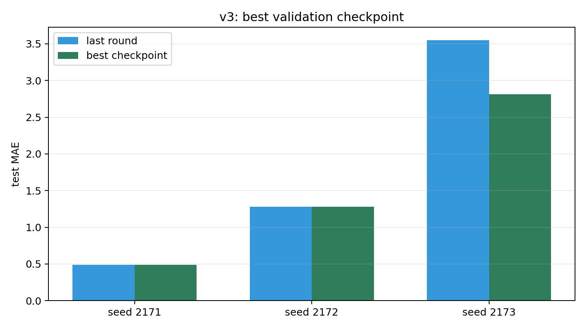

# Grow v3：best validation checkpoint

日期：2026-11-20  
在 v2 基础上加：

- 每轮验证
- 保存 best validation checkpoint
- patience = 4
- 最终用 best checkpoint 测试

---

## 1. 结果

| seed | last round test | best checkpoint test |
| ---: | ---: | ---: |
| 2171 | 0.48755 | 0.48755 |
| 2172 | 1.27788 | 1.27788 |
| 2173 | 3.54762 | **2.81427** |
| 均值 | 1.7710 | **1.5266** |

---

## 2. 效果

- seed 2171：不变
- seed 2172：不变
- seed 2173：3.548 → 2.814
- 平均：1.771 → 1.527

结论：

> best checkpoint 确实避免了“最后一轮变差”。

---

## 3. 早停

patience = 4。

三个 seed 都没有触发早停：

~~~text
seed 2171 最长连续无改善 = 3
seed 2172 最长连续无改善 = 1
seed 2173 最长连续无改善 = 1
~~~

所以在 6 轮内，早停没有实际生效；起作用的是 best checkpoint。

---

## 4. 仍然存在的问题

- 只有 3 个 seed
- 方差仍大：0.49 / 1.28 / 2.81
- 没有 prune
- 没有 per-epoch early stopping
- K=8，不是 2000 深度 DAG

---

## 5. 效率

~~~text
3 seeds 总耗时约 77 s
单 seed 约 26 s
~~~

---

## 6. 下一步

1. 加 per-epoch validation early stopping
2. 加 prune
3. 5–10 seeds
4. 固定数据划分
5. 扩 10k

---

## 7. 一句话

> best checkpoint 把 seed 2173 从 3.55 拉回 2.81，平均从 1.77 降到 1.53；但 seed 方差仍然很大。

---

## 8. 文件

- grow_train_loop_v3.py
- grow_train_loop_v3_result_seed2171.json
- grow_train_loop_v3_result_seed2172.json
- grow_train_loop_v3_result_seed2173.json
- grow_v3_best_checkpoint.png
- GROW_TRAIN_LOOP_V3_REPORT.md
