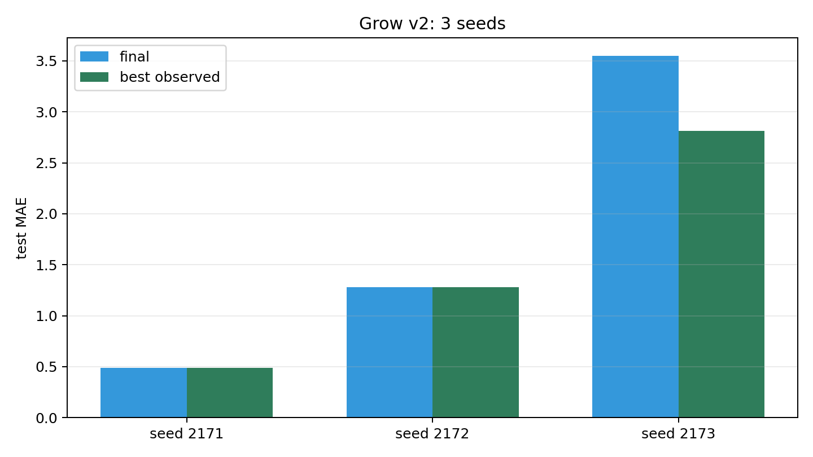

# Grow v2 多 seed 复现

日期：2026-11-20  
配置：2000 → 2300 节点，K=8，3000 样本，6 轮生长。

---

## 1. 目的

v2 单次 test MAE 0.48755 很强，需要确认是不是 seed 运气。

跑了：

~~~text
seed 2171 / 2172 / 2173
~~~

---

## 2. 结果

| seed | final test MAE | best observed test MAE |
| --- | ---: | ---: |
| 2171 | **0.48755** | 0.48755 |
| 2172 | 1.27788 | 1.27788 |
| 2173 | 3.54762 | 2.81427 |

均值：

~~~text
final mean ≈ 1.7710
best mean ≈ 1.5266
~~~

---

## 3. 结论

> 0.48755 不是稳定结果，是三个 seed 里最好的一个。

三个 seed 的 final test MAE：

~~~text
0.49 / 1.28 / 3.55
~~~

方差很大。

所以：

- “生长 + 反传”确实能训练
- 但结果对 seed 很敏感
- 单次 0.49 不能作为结论

---

## 4. 另一个问题

seed 2173 最后一轮不是最好的：

~~~text
final 3.54762
best observed 2.81427
~~~

说明：

> 当前没有用验证集选择最佳 checkpoint。

---

## 5. 效率

~~~text
3 个 seed 总耗时约 77 s
单个 seed 约 25–26 s
~~~

---

## 6. 下一步

1. 加早停：保留 best validation checkpoint
2. 加 prune，不只 grow
3. 更多 seed（5–10）
4. 固定数据划分，减少方差
5. 再扩 10k

---

## 7. 一句话

> v2 的 0.48755 是幸运 seed；三个 seed 平均约 1.77，生长 + 反传还不稳定。

---

## 8. 文件

- grow_train_loop_v2.py
- grow_train_loop_v2_result_seed2171.json
- grow_train_loop_v2_result_seed2172.json
- grow_train_loop_v2_result_seed2173.json
- grow_v2_multiseed.png
- GROW_V2_MULTISEED_REPORT.md
