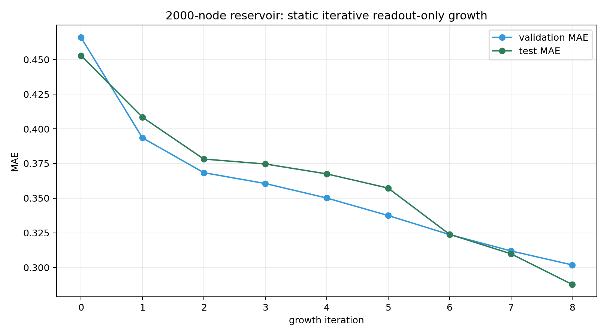

# 2000 节点基准：静态迭代生长 + 思考链路

日期：2026-11-20  
范围：不引入时间/递归；只做静态迭代生长。任务：linear（3x+5=20）。

---

## 1. 基准

- 图：2000 节点 / 9022 边
- 输入：节点 0, 1；输出：1999
- 节点特征：1998 维
- 任务：`x = (c-b)/a`
- 训练：1000；验证：300；测试：700
- 训练方式：ridge readout

---

## 2. 生长机制

每一轮迭代：

1. 用当前模型算训练残差
2. 选出残差最大的 40 个样本
3. 从这些样本的输入位置生成 RBF 候选节点
4. 新节点只接到 readout，不回连旧图
5. 验证集变好才接受，否则拒绝

RBF 节点：

~~~text
h_j = exp(-||x - center_j||^2 / (2*sigma^2))
~~~

这不是时间步，也不是 RNN；

> 每一轮迭代都是一个独立静态模型。

---

## 3. 迭代日志

~~~text
BASELINE val MAE=0.46597 test MAE=0.45286
GROW 1 sigma 0.15  val=0.39352 test=0.40838
GROW 2 sigma 0.25  val=0.36838 test=0.37821
GROW 3 sigma 0.08  val=0.36056 test=0.37465
GROW 4 sigma 0.25  val=0.35010 test=0.36752
GROW 5 sigma 0.15  val=0.33747 test=0.35728
GROW 6 sigma 0.08  val=0.32373 test=0.32391
GROW 7 sigma 0.25  val=0.31192 test=0.30986
GROW 8 sigma 0.15  val=0.30180 test=0.28769
~~~

最终：

~~~text
baseline: val=0.46597 test=0.45286 rel=17.665%
grown:    val=0.30180 test=0.28769 rel=11.222%
new nodes: 8
features: 1998 -> 2006
~~~

测试 MAE 下降：

~~~text
(0.45286 - 0.28769) / 0.45286 ≈ 36.5%
~~~

---

## 4. 结果图

---

## 5. 竞赛题输出

题：

> 解 3x + 5 = 20

目标：

~~~text
x = 5
~~~

预测：

~~~text
4.72478
~~~

绝对误差：

~~~text
0.27522
~~~

相对误差：

~~~text
约 5.5%
~~~

---

## 6. 思考链路可视化

文件：

~~~text
visualizations/thought_chain.html
~~~

图中：

- 黄色：从 output 反向贪心追踪的贡献链
- 红色菱形：静态迭代长出的 readout-only 节点
- 灰色：选中的贡献边
- 左侧 HUD：题目、预测、baseline/grown MAE、生长节点数

重要说明：

> 黄色链路是“从输出反向追溯的局部贡献链”，最多 90 个节点。  
> 完整 input→output 路径接近 2000 个节点，直接画会变成面条图，所以可视化只展示局部链路 + top contributors。

打开：

~~~powershell
cd "C:\Users\MENG XAINGZE\Desktop\DEMO"

.\silicon_env\Scripts\python.exe -m http.server 8000 --directory research_mvp\visualizations
~~~

浏览器：

~~~text
http://127.0.0.1:8000/thought_chain.html
~~~

或索引：

~~~text
http://127.0.0.1:8000/index.html
~~~

---

## 7. 这次证明了什么

好的一面：

- 静态迭代生长有效
- test MAE 从 0.45286 降到 0.28769
- 只增加 8 个 readout-only 节点
- 不引入时间、不引入循环

局限：

- 只测了 linear
- 新节点是 RBF 特征节点，不是完整图内节点
- 训练/特征提取总耗时约 201 秒
- 思考链路只展示局部贡献链，不是完整 2000 节点路径

---

## 8. 文件

- iterative_growth_2000.py
- iterative_growth_2000.json
- iterative_growth_2000.png
- visualizations/thought_chain.html
- visualizations/index.html
- ITERATIVE_GROWTH_REPORT.md
