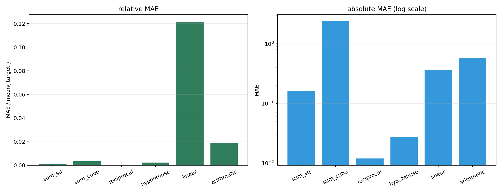

# 2000 节点图：多题型数学测试报告

日期：2026-11-20  
范围：同一个 2000 节点空间图 / 化学场，测试 6 类初中数学题。

---

## 1. 题目族

| 任务 | 题目形式 | 公式 |
| --- | --- | --- |
| sum_sq | 已知 a+b=S, ab=P，求 a²+b² | S²-2P |
| sum_cube | 已知 a+b=S, ab=P，求 a³+b³ | S³-3PS |
| reciprocal | 已知 x+1/x=S，求 x²+1/x² | S²-2 |
| hypotenuse | 直角三角形两直角边 a,b，求斜边 | √(a²+b²) |
| linear | 解 ax+b=c | (c-b)/a |
| arithmetic | 等差数列首项 a1，公差 d，第 n 项 | a1+(n-1)d |

最终竞赛题：

> **a+b=7，ab=12，求 a²+b²。**

答案：25。

---

## 2. 图与化学场

- 节点：2000
- 边：9022
- 最大边距离：16.288
- 输入：节点 0, 1；输出：1999
- 特征：1998 个隐藏节点激活
- 化学场：DA / 5HT / NE / ACh / GABA / Glu

化学场均值：

~~~text
DA   0.041404
5HT  0.045515
NE   0.038781
ACh  0.036331
GABA 0.042638
Glu  0.038695
~~~

Gain 范围：

~~~text
1.03655 .. 1.19505
~~~

---

## 3. 训练方式

同一个 2000 节点 reservoir，每个题型单独训练一个线性 readout：

~~~text
输入 -> 2000 节点空间图 -> 1998 维特征 -> ridge readout
~~~

每个任务：

- 训练：500
- 测试：150
- 共享同一个图、化学场、节点 bias、input gain
- 只训练任务各自的输出头

注意：

> 这不是一个统一的多任务输出头，而是共享 reservoir + 多个任务头。

---

## 4. 运行日志

命令：

~~~powershell
.\silicon_env\Scripts\python.exe research_mvp\large_math_multi.py
~~~

日志：

~~~text
GRAPH nodes 2000 edges 9022 max_edge_distance 16.288
CHEM_MEAN {'DA': 0.0414, '5HT': 0.04551, 'NE': 0.03878, 'ACh': 0.03633, 'GABA': 0.04264, 'Glu': 0.0387}

TASK sum_sq      feature_sec 6.09
TASK sum_cube    feature_sec 12.28
TASK reciprocal  feature_sec 18.53
TASK hypotenuse  feature_sec 24.64
TASK linear      feature_sec 30.92
TASK arithmetic  feature_sec 37.08

RESULT sum_sq      mae 0.1610   rmse 0.2228   rel 0.0013
RESULT sum_cube    mae 2.3934   rmse 3.2754   rel 0.0034
RESULT reciprocal  mae 0.0119   rmse 0.0158   rel 0.0003
RESULT hypotenuse  mae 0.0276   rmse 0.0409   rel 0.0024
RESULT linear      mae 0.3690   rmse 0.5367   rel 0.1217
RESULT arithmetic  mae 0.5816   rmse 1.1934   rel 0.0191

PROBLEM a+b=7, ab=12 target 25 -> 24.8367
~~~

---

## 5. 结果

| 任务 | MAE | RMSE | 相对 MAE |
| --- | ---: | ---: | ---: |
| sum_sq | 0.1610 | 0.2228 | 0.135% |
| sum_cube | 2.3934 | 3.2754 | 0.343% |
| reciprocal | 0.0119 | 0.0158 | 0.031% |
| hypotenuse | 0.0276 | 0.0409 | 0.238% |
| linear | 0.3690 | 0.5367 | 12.175% |
| arithmetic | 0.5816 | 1.1934 | 1.911% |

最终竞赛题：

~~~text
目标：25
预测：24.8367
绝对误差：0.1633
相对误差：约 0.65%
~~~

---

## 6. 结果图

左图：相对 MAE。  
右图：绝对 MAE，log scale。

---

## 7. 耗时

| 阶段 | 时间 |
| --- | ---: |
| 图构建 | 0.043 s |
| 3900 个样本前向 | 37.085 s |
| 6 个 ridge 拟合 | 2.229 s |
| 总计 | 约 39.4 s |

纯 Python + NumPy，无 GPU，无 PyTorch。

---

## 8. 观察

### 好的

- 同一张 2000 节点图可以支撑 6 类不同的代数/几何题。
- 线性 readout 就能拿到很低的相对误差。
- sum_sq、sum_cube、reciprocal、hypotenuse 都很好。
- 最终竞赛题预测 24.8367，误差约 0.65%。

### 不好的

- linear 的相对误差 12.175%，明显最差。
- arithmetic 也有 1.9% 相对误差。
- 这说明 reservoir 特征并不是对所有公式都同样有效。
- 这不是“理解数学”，而是 2000 个非线性特征 + 线性拟合。

---

## 9. 文件

- large_math_multi.py
- large_math_multi_result.json
- large_math_multi.png
- LARGE_MATH_MULTI_REPORT.md

---

## 10. 结论

> 2000 节点图不仅能做单一代数题，还能在同一拓扑上支撑多类初中数学题；  
> 但不同题型难度差异很大，linear 明显比 sum_sq 难。

一句话：

> 题库扩展是可行的；图的容量够，但特征质量因任务而异。
