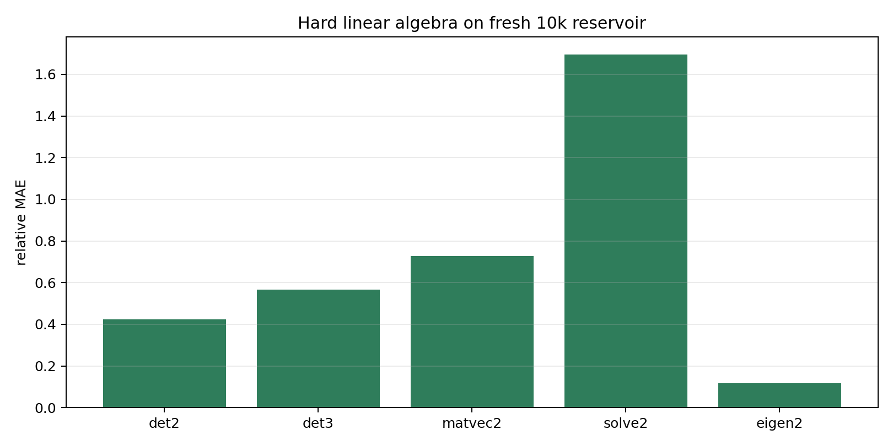

# 高难线性代数测试：fresh 10k reservoir

日期：2026-11-20  
范围：独立 fresh 10k 图；300 训练 / 100 测试；每任务独立 ridge readout。

---

## 1. 任务

| 任务 | 内容 | 输入 | 输出 |
| --- | --- | ---: | ---: |
| det2 | 2×2 行列式 ad-bc | 4 | 1 |
| det3 | 3×3 行列式 | 9 | 1 |
| matvec2 | 2×2 矩阵乘向量 | 6 | 2 |
| solve2 | 2×2 线性方程组 | 6 | 2 |
| eigen2 | 2×2 对称矩阵特征值 | 3 | 2 |

---

## 2. 结果

| 任务 | MAE | RMSE | 相对 MAE |
| --- | ---: | ---: | ---: |
| det2 | 5.00255 | 7.57670 | 42.43% |
| det3 | 8.02062 | 9.90067 | 56.52% |
| matvec2 | 0.84725 | 1.18550 | 72.63% |
| solve2 | 0.47323 | 0.64101 | 169.41% |
| eigen2 | 0.08775 | 0.12958 | 11.83% |

---

## 3. 结论

### 能部分处理的

- eigen2：相对误差 11.83%，是唯一低于 20% 的
- 但仍然不是精确解

### 不能解的

- det2：42%
- det3：57%
- matvec2：73%
- solve2：169%

所以：

> 当前 fresh 10k + ridge readout 基本不能解这些线性代数题。

---

## 4. 为什么

当前结构是：

~~~text
随机图 reservoir
→ 9998 维随机非线性特征
→ 线性 readout
~~~

它没有：

- 精确的乘法结构
- 行列式展开结构
- 除法/消元结构
- 符号计算
- 循环/多步推理

线性代数需要的是**结构化运算**，不是随机特征线性组合。

---

## 5. 效率

~~~text
图：10000 节点 / 40105 边
5 个任务 × 400 样本 = 2000 次前向
总耗时：82.883 s
≈ 41.4 ms / 样本
~~~

---

## 6. 下一步

如果想解：

1. 用 task-specific 特征（乘法、除法、行列式特征）
2. 用小型 MLP readout
3. 用多步 recurrence / 程序化推理
4. 用符号/算法蒸馏
5. 不要指望随机 reservoir + 线性头直接算线性代数

---

## 7. 一句话

> 高难线性代数测试失败：只有 eigen2 有部分信号，det2/det3/matvec2/solve2 都远未解出。当前瓶颈是特征表达，不是节点数量。

---

## 8. 文件

- linear_algebra_10k.py
- linear_algebra_10k_result.json
- linear_algebra_10k.png
- LINEAR_ALGEBRA_10K_REPORT.md
