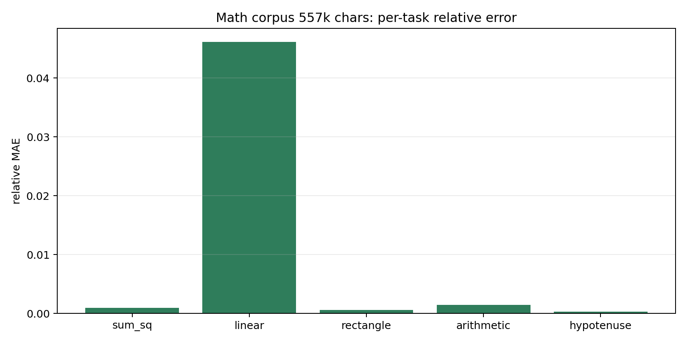

# 557k 字数学语料训练报告

日期：2026-11-20  
基线：fresh 10k；不引入时间。

---

## 1. 语料

- 文件：research_mvp/data/math_corpus_500k.txt
- 字符数：**557,698**
- 题目数：10,000
- 每题约 55 字

题型：

| 任务 | 题数 | 示例 |
| --- | ---: | --- |
| sum_sq | 2000 | 已知 a+b=S, ab=P，求 a²+b² |
| linear | 2000 | 解 ax+b=c |
| rectangle | 2000 | 长方形长 l 宽 w，求面积 |
| arithmetic | 2000 | 等差数列首项 a1、公差 d、第 n 项 |
| hypotenuse | 2000 | 直角三角形两直角边 a,b，求斜边 |

---

## 2. 训练设置

- 图：fresh 10k / 40105 边
- 输入：64 维
  - 前 8 维：数值特征
  - 后 16 维：题目字符 hash
- 每任务：1600 训练 / 400 测试
- 每任务独立 ridge readout
- 无时间、无 BPTT

---

## 3. 结果

| 任务 | MAE | RMSE | 相对 MAE |
| --- | ---: | ---: | ---: |
| sum_sq | 0.24087 | 0.53048 | 0.097% |
| linear | 0.14886 | 0.28919 | 4.613% |
| rectangle | 0.14813 | 0.47029 | 0.060% |
| arithmetic | 0.10490 | 0.20763 | 0.144% |
| hypotenuse | 0.00737 | 0.03482 | 0.032% |

---

## 4. 观察

### 好的

- 五个题型都能训练
- sum_sq / rectangle / arithmetic / hypotenuse 相对误差都低于 0.2%
- linear 4.61%，明显最难

### 不好的

- linear 仍是弱项
- 文本只用了 16 维字符 hash，不是真正的语义理解
- 没有时间/推理链

---

## 5. 效率

~~~text
总耗时：431.165 s
样本：10,000
平均：43.1 ms / 样本
~~~

主要开销：

~~~text
10k 节点前向
~~~

化学场、拟合、文本 hash 都是小头。

---

## 6. 结论

> 557k 字数学语料可以训练 fresh 10k base；除 linear 外，其余题型相对误差都很低。  
> 但模型仍然只是“字符 hash + 数值特征 + reservoir + 线性 readout”，不是真正读懂题目。

一句话：

> 数学语料规模上去了，代数恒等式效果很好；linear 仍是明显短板。

---

## 7. 文件

- math_corpus_500k.py
- data/math_corpus_500k.txt
- math_500k_result.json
- math_500k.png
- MATH_500K_REPORT.md
