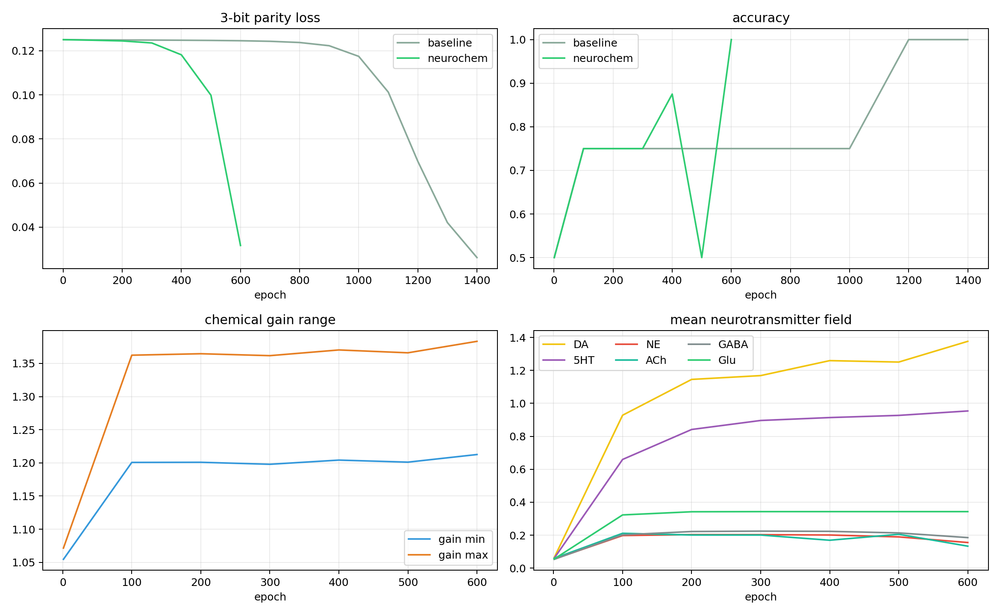

# 神经递质 3 位奇偶校验测试报告

日期：2026-11-20  
范围：只测试 3-bit parity；扩大节点后对比 baseline 与 neurochem。

---

## 1. 任务与扩容

- 输入节点：0, 1, 3
- 输出节点：9
- 8 个 3-bit 样本
- 目标：a XOR b XOR c
- 原始拓扑：25 节点 / 89 边
- 扩容：+12 个 hidden 节点
- 扩容后：37 节点 / 140 边
- 训练：固定拓扑，手写反向传播

扩容锚点：

- 输入节点 3
- 原 hub 22
- 输出节点 9
- 输入节点 0 / 1

每个新节点都会尝试连接：

~~~text
input 0/1 -> new node
parent -> new node
new node -> output
input 3 -> new node
~~~

并且仍然经过 3D 距离约束。

---

## 2. 加入的神经递质

| 递质 | 功能 | 实现 |
| --- | --- | --- |
| DA 多巴胺 | 奖励 / 动机 | 准确率越高，输出节点源越强；提高 gain 与学习率 |
| 5HT 血清素 | 稳定 / 抑制 | 低误差时源增强；增加抑制项 |
| NE 去甲肾上腺素 | 唤醒 / 误差 | loss 越高，输入节点源越强；提高 gain |
| ACh 乙酰胆碱 | 注意 / 可塑性 | 准确率低时输入源增强；提高 gain 与学习率 |
| GABA | 抑制 | loss 越高，hub 源越强；降低 gain |
| Glu 谷氨酸 | 兴奋 | 持续基础源；提高输出节点兴奋性 |

~~~text
dc_i/dt = D * sum_j w_ij (c_j - c_i) + source_i - decay_i c_i
~~~

~~~text
exc = 0.8*Glu + 0.6*DA + 0.4*NE + 0.3*ACh
inh = 0.9*GABA + 0.4*5HT

gain = 1 + 0.8*exc/(1+exc) - 0.45*inh/(1+inh)
~~~

学习率：

~~~text
lr_factor = 1 + 0.25*DA + 0.20*ACh - 0.15*GABA + 0.05*5HT
~~~

---

## 3. 运行日志

命令：

~~~powershell
.\silicon_env\Scripts\python.exe research_mvp\neurochem_parity.py
~~~

### 扩容

~~~text
EXPANDED nodes 37 edges 140
paths = {'0': [0, 9], '1': [1, 9], '3': [3, 9]}
~~~

### Baseline

~~~text
epoch=0001 loss=0.125065 acc=0.500
epoch=0100 loss=0.124923 acc=0.750
epoch=0400 loss=0.124781 acc=0.750
epoch=0800 loss=0.123744 acc=0.750
epoch=1100 loss=0.101236 acc=0.875
epoch=1200 loss=0.069813 acc=1.000
epoch=1400 loss=0.026186 acc=1.000
~~~

最终：

~~~text
epochs_run = 1467
loss = 0.019968
acc = 1.000
~~~

### Neurochem

~~~text
epoch=0001 loss=0.125031 acc=0.500 gain=[1.055,1.072]
epoch=0100 loss=0.124784 acc=0.750
epoch=0200 loss=0.124463 acc=0.750
epoch=0400 loss=0.118163 acc=0.875
epoch=0500 loss=0.099833 acc=0.500
epoch=0600 loss=0.031681 acc=1.000
~~~

最终：

~~~text
epochs_run = 654
loss = 0.019916
acc = 1.000
~~~

---

## 4. 结果

| 模式 | 节点 | 边 | epochs | 训练秒数 | ms/epoch | 最终 loss | 最终 acc |
| --- | ---: | ---: | ---: | ---: | ---: | ---: | ---: |
| baseline | 37 | 140 | 1467 | 1.276 | 0.870 | 0.019968 | 1.000 |
| neurochem | 37 | 140 | 654 | 0.735 | 1.124 | 0.019916 | 1.000 |

结论：

> 扩容后，baseline 和 neurochem 都学会了 3-bit parity。  
> 神经递质把收敛从 1467 轮缩短到 654 轮，约 2.24 倍 epoch 加速；  
> 实际 wall-clock 从 1.276 秒降到 0.735 秒，约 1.74 倍加速。

### 效率拆解

- 每个 epoch 的化学开销：0.870 → 1.124 ms，约 +29%
- 但收敛所需 epoch 少 2.24 倍
- 总时间仍快 1.74 倍
- 6 个化学场 × 37 节点，内存开销可以忽略
- 当前是纯 Python 逐节点扩散；图更大时，化学项会成为主要开销

---

## 5. XOR 输出

Baseline：

~~~text
000 -> 0.20212
001 -> 0.80666
010 -> 0.77110
011 -> 0.18670
100 -> 0.80779
101 -> 0.22351
110 -> 0.18654
111 -> 0.82028
~~~

Neurochem：

~~~text
000 -> 0.20298
001 -> 0.80492
010 -> 0.77253
011 -> 0.18699
100 -> 0.80794
101 -> 0.22015
110 -> 0.18853
111 -> 0.82169
~~~

---

## 6. 最终化学场

~~~text
DA   = 1.45628
5HT  = 0.96923
NE   = 0.14258
ACh  = 0.12593
GABA = 0.17157
Glu  = 0.34305
~~~

输出节点 gain：

~~~text
1.38956
~~~

---

## 7. 输出路径

结果 JSON 现在包含：

~~~json
{
  "input_to_output_paths": {
    "0": [0, 9],
    "1": [1, 9],
    "3": [3, 9]
  },
  "output_files": {
    "result_json": "research_mvp/neurochem_parity_result.json",
    "expanded_graph": "research_mvp/neurochem_expanded_graph.json",
    "report": "research_mvp/NEUROCHEM_PARITY_REPORT.md",
    "curves_png": "research_mvp/neurochem_parity_curves.png"
  }
}
~~~

---

## 8. 曲线

---

## 9. 文件

- neurochem_parity.py
- neurochem_parity_result.json
- neurochem_expanded_graph.json
- neurochem_parity_curves.png
- neurochem_diffusion.py
- neurochem_3d.png

---

## 10. 结论

这次只做 3-bit parity，没有跑其他任务。

扩容解决了容量问题：

- 扩容前：3-bit parity 失败
- 扩容后：baseline 和 neurochem 都通过
- 神经递质没有改变最终精度，但明显加快了收敛

一句话：

> 节点扩容让网络具备学习 3-bit parity 的容量；神经递质场在这个容量上把收敛速度提高了约 2.24 倍。
