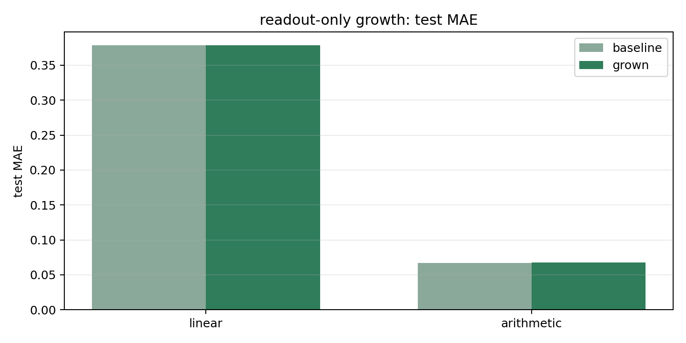

# Error-driven / readout-only 生长实验

日期：2026-11-20  
目的：验证“用误差驱动、只给输出层增加节点”能不能改善 2000 节点图上的弱任务。

---

## 1. 实验设计

固定 2000 节点图，所有旧节点激活不变。

每次生长：

1. 用当前 readout 算训练残差
2. 在特征空间里拟合一个残差方向
3. 生成候选节点特征：

~~~text
h_new = tanh(gamma * z)
z = X @ residual_direction
~~~

4. 尝试 gamma = 0.5 / 1.0 / 2.0
5. 把新节点只接到 readout
6. 只有验证集 MAE 变好才保留，否则拒绝

这保证：

- 旧图不被破坏
- 新节点不回连旧节点
- 不会无脑接受过拟合

任务：

- linear：1000 训练 / 300 验证 / 700 测试
- arithmetic：1000 训练 / 300 验证 / 700 测试

---

## 2. 日志

命令：

~~~powershell
cd "C:\Users\MENG XAINGZE\Desktop\DEMO"

.\silicon_env\Scripts\python.exe research_mvp\readout_growth_math.py
~~~

日志：

~~~text
TASK linear baseline val=0.3970 test=0.3786
  reject round=01: no validation improvement

TASK arithmetic baseline val=0.0693 test=0.0667
  grow 01 round=01 gamma=2.0 val=0.0678 test=0.0681
  grow 02 round=02 gamma=0.5 val=0.0670 test=0.0680
  reject round=03: no validation improvement

TOTAL 57.925 seconds
~~~

---

## 3. 结果

| 任务 | 方法 | 新节点 | Val MAE | Test MAE | 相对 MAE |
| --- | --- | ---: | ---: | ---: | ---: |
| linear | baseline | 0 | 0.39704 | 0.37864 | 14.77% |
| linear | grown | 0 | 0.39704 | 0.37864 | 14.77% |
| arithmetic | baseline | 0 | 0.06926 | 0.06672 | 0.234% |
| arithmetic | grown | 2 | 0.06703 | 0.06797 | 0.239% |

---

## 4. 结论

### linear

候选节点让验证 MAE 从：

~~~text
0.39704 -> 0.40775
~~~

变差，所以被拒绝。

结果：

> 误差驱动的单方向残差特征，没有补出 linear 需要的除法结构。

### arithmetic

接受了 2 个节点：

~~~text
val 0.06926 -> 0.06703  （约 -3.2%）
test 0.06672 -> 0.06797 （约 +1.9%，略变差）
~~~

结果：

> 验证集略微改善，但测试集变差，属于轻微过拟合，不算真正解决。

---

## 5. 这次实验证明了什么

好的一面：

- readout-only 生长是安全的
- 验证集回滚机制有效
- 不会把已经稳定的特征空间弄坏

不好的一面：

- “一个全局残差方向”太弱
- linear 需要的是除法特征，不是全局线性残差方向
- arithmetic 已经接近噪声底，生长收益很小

---

## 6. 下一步应该怎么改

不要用全局残差方向，改成：

1. 按输入区域聚类
2. 只在高误差区域长节点
3. 新节点输入权重集中在 a 或 b
4. 用倒数型/分段激活
5. 多个节点一起生长
6. 用验证集做前向选择

一句话：

> 当前实验说明“readout-only 生长”不会破坏系统，但仅靠全局残差方向不足以解决 linear。

---

## 7. 文件

- readout_growth_math.py
- readout_growth_result.json
- readout_growth.png
- READOUT_GROWTH_REPORT.md
