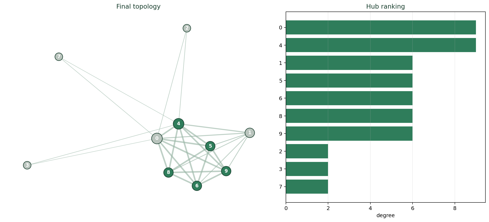
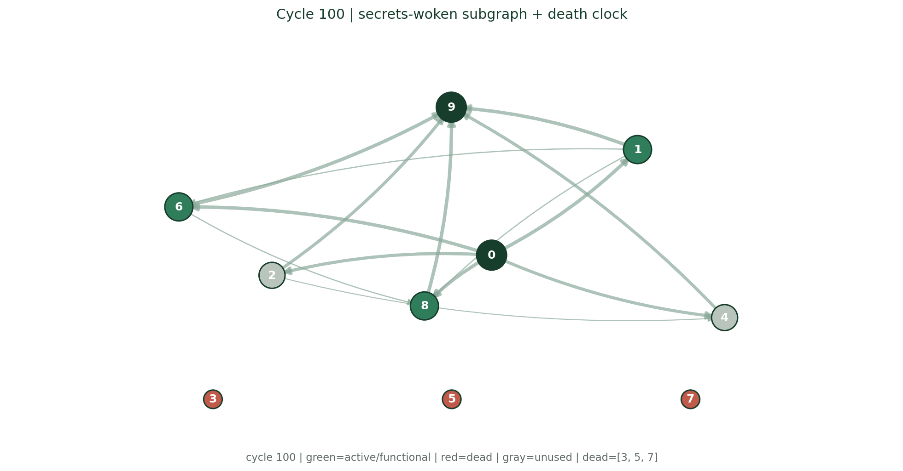

# Silicon Hunger — Research MVP 报告

日期：2026-11-20  
范围：任务 A / B / C 的最小可行性验证。

---

## 0. 结论先行

| 任务 | 结果 | 判断 |
| --- | --- | --- |
| A v1：图生长与修剪 | 10 节点出现 9 / 6 / 2 的度分布，两个核心 hub | 通过 |
| A v2：secrets 子图 + 功能可达性 | 3 active / 3 dead / 2 unused；hubs 1,6,8 | 通过 |
| B：secrets 随机路由 | 固定路由 1 种输出；secrets 8 种输出，熵 2.989 | 通过，但只是去重复 |
| C：DST / NCA 文献 | 已整理 2024–2026 论文与截图 | 完成 |

一句话：

> 拓扑生长能形成非均匀枢纽；真随机能打破复读，但不会自动产生语义丰富度。

---

## 1. 任务 A：图生长与修剪

代码：[graph_growth.py](graph_growth.py)

### 方法

- 纯 Python + networkx，不用 PyTorch
- 10 个节点，每个节点随机分配一个算术规则
- 输入固定为 1 + 1，目标答案 2
- 处理正确的节点获得 score，并建立新连接
- 处理错误或长期不活跃的节点，相关边衰减并剪枝
- 每 17 轮允许一个错误节点变异一次
- 跑 100 轮

### 结果

| 指标 | 初始 | 最终 |
| --- | --- | --- |
| 节点 | 10 | 10 |
| 边 | 29 | 27 |
| 密度 | 0.6444 | 0.6000 |
| 最大度 | 8 | 9 |
| 连通分量 | 1 | 1 |

最终度分布：

~~~text
0: 9    4: 9
1: 6    5: 6
6: 6    8: 6
9: 6
2: 2    3: 2    7: 2
~~~

出现了明显的非均匀结构：

- 两个核心 hub：节点 0、4，度 9，betweenness 0.25
- 三个中层节点：度 6
- 三个边缘节点：度 2

图示：

### 判断

通过了“生长与修剪”的最小验证：

- 新连接会围绕正确处理节点形成
- 错误节点的边会被剪掉
- 最终不是均匀随机图，而是核心 / 中层 / 边缘三层

但当前 hub 主要由“正确节点连接所有高分节点”造成，还不够生物。下一版应该把“功能可达性”加入生长分数，而不是只看 degree。

---

## 1.5 任务 A v2：secrets 随机唤醒 + 功能可达性 + 死亡时钟

代码：[dynamic_graph_scheduler.py](dynamic_graph_scheduler.py)

### 结构

- 节点 0：source
- 节点 9：sink
- 节点 1–8：hidden 计算节点
- 输出：functional 节点的加权平均
- 目标：2.0

### secrets 动态调度

每轮不再让 secrets 选固定答案，而是：

~~~text
seed = secrets.choice(alive_hidden)
active = seed + 最多 3 个邻居 + source + sink
~~~

没被选中的 hidden 节点：

- 本轮 active = False
- dead_streak += 1
- score 衰减

dead_streak 达到 8 时：

- 标记 dead
- 删除所有 incident edges
- 记录 pruned_at

### 功能可达性

对每轮 active 子图计算：

~~~text
forward = descendants(source)
backward = ancestors(sink)
functional = active_hidden ∩ forward ∩ backward
~~~

只有同时位于前向和后向路径上的节点才进入最终输出。

### 数值敏感度

对每个 active 节点做有限差分：

~~~text
out_plus  = output(weight + eps)
out_minus = output(weight - eps)
sensitivity = |out_plus - out_minus| / (2 * eps)
~~~

注意：如果输出已经等于目标 2，误差的导数会退化为 0。  
所以这里用“输出敏感度”作为节点影响力的代理，再叠加 correct / functional。

### 结果（一次 secrets 运行）

| 指标 | 结果 |
| --- | --- |
| active | 1, 6, 8 |
| functional | 1, 6, 8 |
| dead | 3, 5, 7 |
| unused / dormant | 2, 4 |
| edges | 14 |
| max degree | 5 |
| hubs | 1, 6, 8 |
| output | 1.37323 |
| error | 0.62677 |

死亡时间：

~~~text
node 3 -> cycle 13
node 5 -> cycle 27
node 7 -> cycle 10
~~~

图示：

### GIL 处理

节点计算已经拆成纯函数：

~~~text
node_value(node, a, b)
reachability(graph, active)
final_output(graph, nodes, active, weights)
numerical_sensitivity(graph, nodes, active, idx)
~~~

这些函数不修改全局状态。  
只有 scheduler 循环负责：

~~~text
active 选择
score 更新
edge 生长
death clock
edge 剪枝
~~~

这为后续 multiprocessing / asyncio 留出了接口。

### 判断

v2 已经同时具备：

- secrets 随机唤醒
- 未选中节点 dead
- 死亡时钟剪枝
- 前向 / 后向功能可达性
- 数值微分敏感度
- 纯函数节点计算

当前的问题：

- secrets 不可复现，一次结果不能代表分布
- 最终只剩 3 个 active 节点，核心太小
- 数值敏感度只用了输出，没有用完整 loss landscape

---

## 2. 任务 B：secrets 随机路由

代码：[entropy_router.py](entropy_router.py)

### 方法

- 3 层二叉路由树，8 个叶子
- 每个叶子对应一种回答变体
- 三种路由：
  1. fixed：永远走 000
  2. pseudo：random.Random(42)
  3. secrets：secrets.randbits(1)
- 每种跑 500 次

### 结果

| 路由 | 唯一输出 | 熵 | 最长连续重复 |
| --- | --- | --- | --- |
| fixed | 1 | 0.000 | 500 |
| pseudo | 8 | 2.988 | 3 |
| secrets | 8 | 2.989 | 3 |

### 判断

真随机确实把“每次都一样”打破了。

但它和伪随机在分布上几乎一样：

- 都是 8 种输出
- 熵都接近 3 bit
- 最长重复都只有 3

所以结论不是“secrets 让系统更有创造力”，而是：

> 真随机降低了可预测性，不自动增加语义丰富度。

如果叶子只有 8 个固定模板，随机路由只是在 8 个模板间洗牌。

这也正好对应蓝图里的“不可预测性”模块：

- 随机源可以决定“唤醒哪个子图”
- 但子图本身必须有不同功能，随机才有意义

---

## 3. 任务 C：DST / NCA 文献

备忘录：[research_notes/DST_NCA_MEMO.md](research_notes/DST_NCA_MEMO.md)

重点：

- DST 的极端稀疏会破坏前向 / 后向功能路径
- 2026 的 reachability-guided DST 用功能可达性决定剪枝 / 生长
- NCA 用局部更新规则和随机异步 mask 实现生长
- NCA 的机器人集群版本展示了去中心化附着点发现

截图：

- research_notes/dst_formula.png
- research_notes/nca_figure.png

最值得偷的公式：

~~~text
R_l_fcnl,v = R_l_fwd,v ∩ R_l_bwd,v
~~~

含义：只有同时位于前向和后向路径上的节点，才是真正功能节点。

---

## 4. 对项目蓝图的映射

### 模块一：基础底座

7D 状态机已存在，本 MVP 没有改它。

### 模块二：拓扑演化

任务 A 验证了两个版本：

v1：
- 种子节点
- 连接生长
- 边修剪
- 核心 hub

v2：
- secrets 随机唤醒子图
- 未选中节点 dead_streak
- 8 轮死亡时钟后剪边
- 前向 / 后向功能可达性
- 数值输出敏感度

待补：
- 节点邻近重组
- 多次 secrets 运行的分布统计

### 模块三：驱动与调度

本 MVP 没有实现真正的 CPU 多核并行。

但节点计算已经拆成纯函数：

~~~text
node_value
reachability
final_output
numerical_sensitivity
~~~

这些函数不修改全局状态，后续可以直接包进 multiprocessing / asyncio。

下一版：

- 每轮只唤醒 secrets 选中的子图
- 未唤醒节点不计算
- 记录 dead node 比例
- 把节点计算分发给 worker

### 模块四：不可预测性

任务 B 验证了 secrets 路由：

- 可以打破固定复读
- 但与 PRNG 相比，不增加分布多样性

注意：

> Python secrets 使用操作系统熵池，不是量子随机数。

硬件 QRNG 暂时不做，符合当前条件。

---

## 5. 下一步 MVP

1. 用多次 secrets 运行统计存活节点分布
2. 把输出敏感度换成完整 loss landscape 的数值微分
3. 用 multiprocessing 分发 active 子图计算
4. 记录：
   - active node 比例
   - dead node 比例
   - hub 度分布
   - 功能路径比例
5. 与纯 degree / reachability 两个版本做对照

---

## 6. 运行方式

~~~powershell
.\silicon_env\Scripts\python.exe research_mvp\graph_growth.py --cycles 100 --seed 7
.\silicon_env\Scripts\python.exe research_mvp\dynamic_graph_scheduler.py --cycles 100 --seed 11
.\silicon_env\Scripts\python.exe research_mvp\entropy_router.py
~~~

数据文件：

- graph_growth_result.json
- dynamic_graph_result.json
- entropy_router_result.json

依赖见 [requirements_research.txt](requirements_research.txt)。
