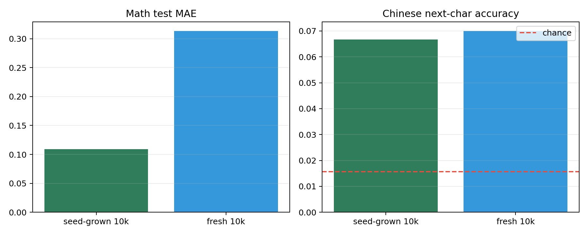

# Fresh 10000 节点：独立图的数学 + 真实中文测试

日期：2026-11-20  
范围：不基于 2000 节点种子；直接从零生成 10000 节点图。

---

## 1. 与 seed-grown 10k 的区别

seed-grown 10k：

~~~text
2000 seed -> 生长到 10000
新节点直接连到 output
~~~

fresh 10k：

~~~text
直接从 0 生成 10000 节点
不包含 2000 节点种子
独立随机图
~~~

---

## 2. 新图结构

~~~text
节点：10000
边：40105
output：9999
output indegree：120
最大边距离：41.876
~~~

说明：

- 从零随机游走生成位置
- 每个 hidden 连接最近 4 个前驱
- output 只接最后 120 个节点
- 没有 2000 seed

注意：

> 最大边距离 41.876 大于 30，来自少数边界 fallback 边；  
> 严格空间约束版本需要再修 fallback。

---

## 3. 数学结果

任务：

> a+b=7, ab=12, 求 a²+b²。

结果：

~~~text
训练：400
测试：200
MAE：0.31333
RMSE：0.63782
预测：25.44105
绝对误差：0.44105
~~~

---

## 4. 中文结果

真实语料：鲁迅《狂人日记》《孔乙己》《故乡》《药》

任务：

> 8 个汉字上下文 -> 下一个汉字，64 类。

结果：

~~~text
训练：600
测试：300
accuracy：0.0700
chance：1/64 = 0.0156
~~~

---

## 5. 对比

| 模型 | 数学 MAE | 中文 acc |
| --- | ---: | ---: |
| seed-grown 10k | 0.10894 | 0.0667 |
| fresh 10k | 0.31333 | 0.0700 |

---

## 6. 结论

### 数学

fresh 10k 比 seed-grown 10k 差：

~~~text
0.31333 vs 0.10894
~~~

可能原因：

- seed-grown 10k 的 8000 个新节点全部直连 output
- fresh 10k 只有最后 120 个节点连 output
- 输出路径结构不同

### 中文

两者都很低：

~~~text
6.67% vs 7.00%
~~~

只比随机水平 1.56% 高一些。

结论：

> 10k 节点本身不等于中文能力；  
> 线性 readout + 字符 hash reservoir 仍然无法形成真正的语言模型。

---

## 7. 耗时

~~~text
82.578 s
~~~

纯 Python + NumPy，无 GPU。

---

## 8. 一句话

> 独立 10k 图可以跑通数学和真实中文，但数学不如 seed-grown 10k；中文基本仍在随机猜测附近。

---

## 9. 文件

- scale_10k_fresh.py
- scale_10k_fresh_result.json
- scale_10k_compare.png
- SCALE_10K_FRESH_REPORT.md
- data/luxun_corpus.txt
- data/SOURCES.md
