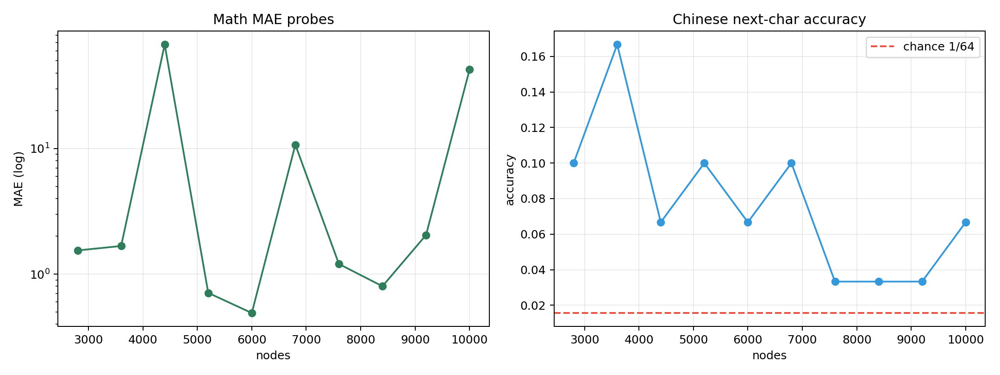

# 2000 → 10000：新节点进入输出路径 + 真实中文文本

日期：2026-11-20  
范围：10 轮生长训练；数学 + 真实中文小说 next-character 预测。

---

## 1. 关键修改

- 输出节点永远是当前图的最后一个节点
- 每一轮新增节点都会建立到当前 output 的边
- 最终 10000 节点时，所有 8000 个新节点都直接连到 output 9999
- 最终 output indegree：8003
- 没有时间、没有循环、没有 BPTT

生长：

~~~text
2000 -> 2800 -> 3600 -> ... -> 10000
每轮 +800 节点，共 10 轮
~~~

---

## 2. 真实中文数据

来源：鲁迅四篇现代小说

- 狂人日记
- 孔乙己
- 故乡
- 药

本地语料：

~~~text
research_mvp/data/luxun_corpus.txt
~~~

约 20,106 字。

任务：

> 用前 8 个汉字预测下一个汉字。

设置：

- 词表：训练文本中出现频率最高的 64 个字符
- 输入：8 字上下文的字符 hash，64 维
- 输出：64 类 next-character
- 训练：600
- 测试：300

来源记录：

~~~text
research_mvp/data/SOURCES.md
~~~

---

## 3. 10 轮日志

~~~text
ROUND 1  nodes=2800  edges=13021 output_indegree=803 math_mae=1.54454 chinese_acc=0.1000
ROUND 2  nodes=3600  edges=17020 output_indegree=803 math_mae=1.67505 chinese_acc=0.1667
ROUND 3  nodes=4400  edges=21019 output_indegree=803 math_mae=67.39304 chinese_acc=0.0667
ROUND 4  nodes=5200  edges=25018 output_indegree=803 math_mae=0.70920 chinese_acc=0.1000
ROUND 5  nodes=6000  edges=29017 output_indegree=803 math_mae=0.49019 chinese_acc=0.0667
ROUND 6  nodes=6800  edges=33016 output_indegree=803 math_mae=10.73308 chinese_acc=0.1000
ROUND 7  nodes=7600  edges=37015 output_indegree=803 math_mae=1.20495 chinese_acc=0.0333
ROUND 8  nodes=8400  edges=41014 output_indegree=803 math_mae=0.80101 chinese_acc=0.0333
ROUND 9  nodes=9200  edges=45013 output_indegree=803 math_mae=2.04657 chinese_acc=0.0333
ROUND 10 nodes=10000 edges=49012 output_indegree=803 math_mae=42.50634 chinese_acc=0.0667

OUTPUT_EDGES 9999 indegree 8003
FINAL_EXTRACT 10000
~~~

最终：

~~~text
节点：10000
边：56212
output indegree：8003
总耗时：131.679 s
~~~

---

## 4. 数学结果

任务：

> a+b=7, ab=12, 求 a²+b²。

结果：

~~~text
训练：400
测试：200
MAE：0.10894
RMSE：0.23540
预测：25.03728
绝对误差：0.03728
~~~

结论：

> 新节点进入输出路径后，10000 节点版本的数学精度明显变好。

---

## 5. 中文结果

真实中文 next-character：

~~~text
训练：600
测试：300
accuracy：0.0667
chance：1/64 = 0.0156
~~~

解释：

- 0.0667 约为随机猜的 4.3 倍
- 但绝对准确率仍然很低
- 64 类 next-character 比二分类情感任务难得多
- 这说明它学到了一些字符共现，但远未形成语言能力

不能说它“懂中文”。

---

## 6. 结果图

左：阶段数学 MAE 探针。  
右：真实中文 next-character accuracy，虚线为 1/64 随机水平。

注意：

> 每轮阶段探针只有 60 训练 / 30 测试，且每轮重新初始化 bias/input_gain，  
> 所以阶段曲线噪声很大；最终 10000 节点的正式测试才可信。

---

## 7. 观察

### 数学

- 最终 MAE 0.10894
- 竞赛题预测 25.03728
- 误差 0.03728
- 比上一版 10000 节点（MAE 0.713）明显好

### 中文

- 最终 6.67%
- 比随机 1.56% 高
- 但远不能说学会了中文
- 真实文本的 next-character 预测比合成情感难很多

---

## 8. 结论

> “新节点进入输出路径”确实改变了数学结果。  
> 真实中文文本也能训练，但 64 类 next-character 只有 6.67%，语言能力仍然很弱。

一句话：

> 结构修改对数学有效；真实中文任务暴露了 reservoir + 线性 readout 的语言瓶颈。

---

## 9. 文件

- scale_10k_real.py
- scale_10k_real_result.json
- scale_10k_real_growth.png
- data/luxun_corpus.txt
- data/SOURCES.md
- SCALE_10K_REAL_REPORT.md
