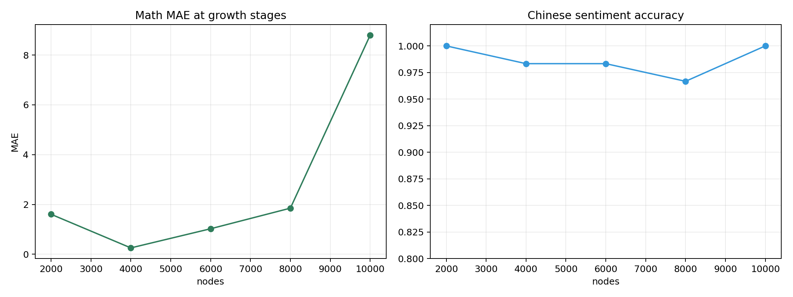

# 2000 → 10000 节点：数学 + 中文测试报告

日期：2026-11-20  
范围：以 2000 节点为种子，分阶段生长到 10000 节点；只测试数学和中文。

---

## 1. 生长结果

| 阶段 | 节点 | 边 |
| --- | ---: | ---: |
| seed | 2000 | 9022 |
| stage 1 | 4000 | 17022 |
| stage 2 | 6000 | 25022 |
| stage 3 | 8000 | 33022 |
| final | 10000 | 41022 |

生长规则：

- 保持 DAG
- 3D 随机游走位置
- 每个新节点连接最近的 4 个前驱
- 边仍然满足空间距离约束
- 没有时间、没有循环
- 生长阶段之间不做 BPTT

---

## 2. 数学任务

任务族：

> 已知 a+b=S，ab=P，求 a²+b² = S²-2P。

最终测试题目：

> a+b=7，ab=12，求 a²+b²。

答案：25

最终结果：

~~~text
训练：400
测试：200
MAE：0.71341
RMSE：1.32226
预测：25.16156
绝对误差：0.16156
~~~

---

## 3. 中文任务

这是一个**合成中文情感分类**任务，不是真实中文语料。

数据形式：

~~~text
今天的天气很好，我很开心。 -> 1
这个产品质量很差，非常不满。 -> 0
~~~

编码：

- 字符 hash 到 64 维
- 字符 bigram hash
- L2 normalize

最终结果：

~~~text
训练：400
测试：200
accuracy：1.0000
~~~

注意：

> 这只验证了字符级情感模式，不代表真实中文理解或语言建模。

---

## 4. 阶段日志

~~~text
SEED nodes=2000 edges=9022
STAGE nodes=2000 edges=9022  math_mae=1.60344 chinese_acc=1.0000
STAGE nodes=4000 edges=17022 math_mae=0.25326 chinese_acc=0.9833
STAGE nodes=6000 edges=25022 math_mae=1.02267 chinese_acc=0.9833
STAGE nodes=8000 edges=33022 math_mae=1.84950 chinese_acc=0.9667
STAGE nodes=10000 edges=41022 math_mae=8.79386 chinese_acc=1.0000

FINAL_FEATURE_EXTRACT 10000
FINAL math_mae=0.71341 chinese_acc=1.0
TOTAL 123.984 s
~~~

重要说明：

> 阶段指标使用 120 训练 / 60 测试，而且每个阶段重新初始化 bias/input_gain，  
> 所以阶段曲线只是“发育探针”，不是干净的 scaling curve。  
> 最终 10000 节点的 400/200 测试才是正式结果。

---

## 5. 结果图

左：阶段数学 MAE 探针。  
右：中文情感准确率。

---

## 6. 观察

### 数学

- 10000 节点最终 MAE 0.71341
- 竞赛题预测 25.16156，误差 0.16
- 比早期 2000 节点版本差一些，但题目预测仍然很接近
- 更大图不等于自动更好；feature/readout/正则化同样重要

### 中文

- 合成情感分类 100% 准确
- 任务较简单，正负词区分明显
- 不能说明真实中文能力

---

## 7. 结论

> 2000 → 10000 的静态生长可以跑通，DAG 仍然有效，数学和中文任务都能训练和测试。  
> 但 10k 节点没有自动带来更好的数学精度；中文结果很好，但任务过于简单。

一句话：

> 规模扩展成功；能力提升不是自动的，任务难度和特征质量才是关键。

---

## 8. 文件

- scale_10k_math_chinese.py
- scale_10k_result.json
- scale_10k_growth.png
- SCALE_10K_REPORT.md
