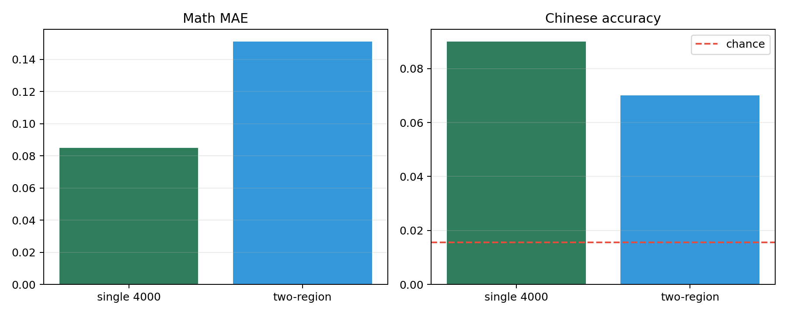

# 双脑区试验：2×2000 vs 1×4000

日期：2026-11-20  
目的：中文区 + 数学区，是否能优于单个 4000 节点图。

---

## 1. 结构

### A. 单个 4000 节点图

~~~text
4000 节点
16105 边
3998 维特征
~~~

### B. 两个 2000 节点图

~~~text
中文区：2000 节点
数学区：2000 节点
各自 1998 维特征
concat → 3996 维
~~~

两个区目前都是**固定随机 reservoir**，只训练 readout。

---

## 2. 结果

| 模型 | 数学 MAE | 中文 acc |
| --- | ---: | ---: |
| single 4000 | **0.08498** | **0.0900** |
| two-region | 0.15116 | 0.0700 |

---

## 3. 分区内部

| 区域 | 数学 MAE | 中文 acc |
| --- | ---: | ---: |
| 中文区 | 0.14909 | **0.0533** |
| 数学区 | 0.43782 | 0.0667 |

观察：

- 中文区在中文上略好（0.0533 vs 0.0667）
- 数学区在数学上反而更差（0.43782 vs 0.14909）
- 没有形成“数学区数学更强”的分化

---

## 4. 结论

> 双脑区这次没有优于单个 4000 节点图。

数学：

~~~text
single 4000：0.08498
two-region：0.15116
~~~

中文：

~~~text
single 4000：0.0900
two-region：0.0700
~~~

更准确地说：

> 两个区只是两个随机 reservoir 的拼接，不是两个训练分化后的脑区。

---

## 5. 为什么失败

1. 图本身没有训练，只是随机固定
2. 两个 region 只是不同随机种子
3. concat 把两个噪声特征空间拼在一起
4. 没有跨区连接
5. 没有 task gate / routing
6. 没有区域特异性可塑性

---

## 6. 效率

~~~text
single 4000 特征：32.066 s
dual 2000 特征：32.918 s
总耗时：72.210 s
~~~

---

## 7. 下一步

要真正做“双脑区”，至少需要：

1. 跨区边（中文区 ↔ 数学区）
2. task gate / router
3. 区域特异 readout 预训练
4. 区域特异可塑性
5. 比较 2000+2000 vs 4000 的干扰矩阵

---

## 8. 一句话

> 两个随机 2000 节点区拼起来，没有产生脑区级分化；单个 4000 节点图反而更好。  
> 要验证“双脑区”，必须让两个区真正分化，而不是只换随机种子。

---

## 9. 文件

- two_region_brain.py
- two_region_result.json
- two_region.png
- TWO_REGION_REPORT.md
