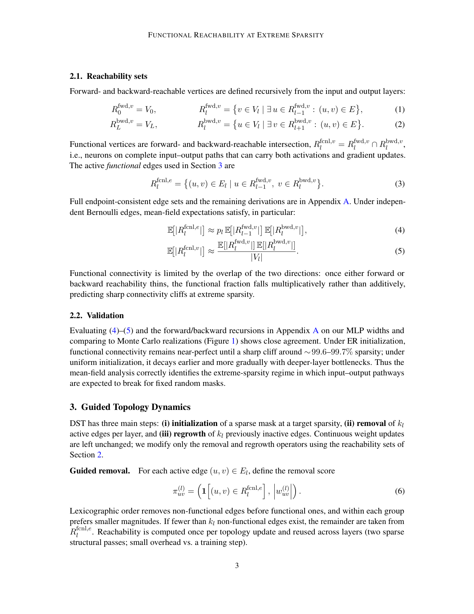
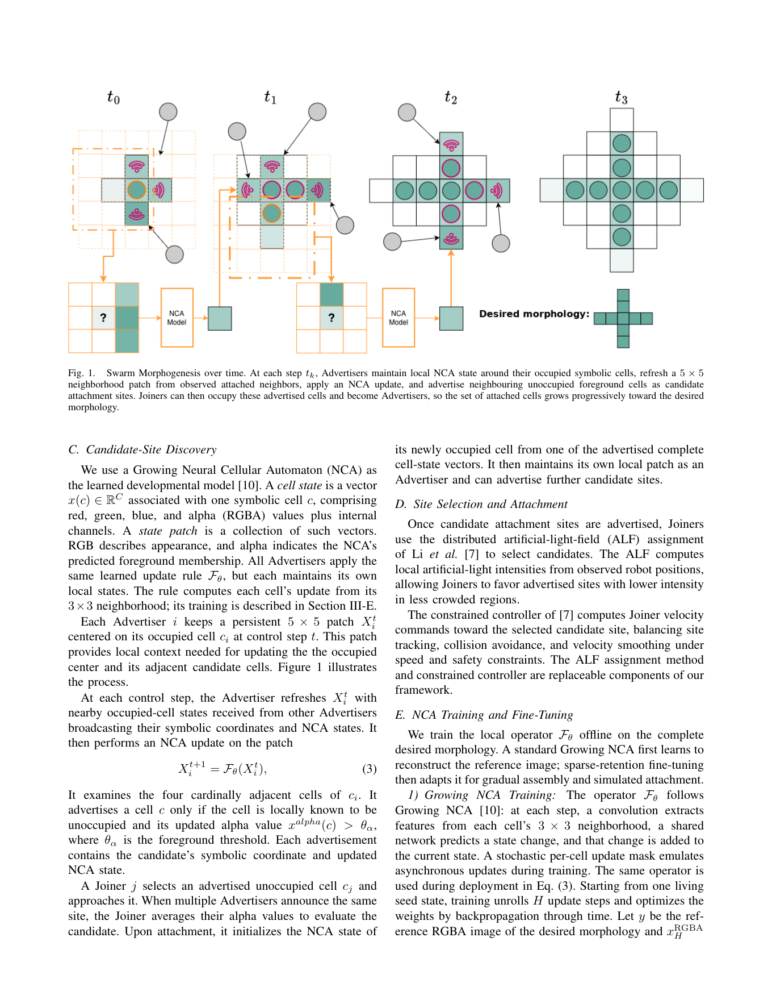

# DST / NCA 文献备忘录

日期：2026-11-20  
用途：为 Silicon Hunger 的“生长 / 修剪 / 随机调度”路线提供参考。

---

## 1. 最值得偷的结论

### 1.1 DST：修剪和生长不能只看幅度

2026 年的 When Sparsity Breaks Connectivity 把 DST 看成一个离散拓扑动力系统：

- 前向可达
- 后向可达
- 功能可达 = 两者交集
- 只有功能边才同时承载 activation 和 gradient

来源：arXiv 2610.17425，第 3 页。

关键公式：

~~~text
R_l_fwd,v = {v in V_l | 存在 u in R_(l-1)_fwd,v 且 (u,v) in E}
R_l_bwd,v = {u in V_l | 存在 v in R_(l+1)_bwd,v 且 (u,v) in E}
R_l_fcnl,v = R_l_fwd,v ∩ R_l_bwd,v
~~~

直观含义：

> 一条边如果不在任何完整的输入—输出路径上，它就不应该获得生长预算。

这正好对应 Task A 里的问题：

~~~text
degree 高 != 功能重要
hub 大 != 一定该保留
~~~

### 1.2 DST 在 RL 里的真正问题是 plasticity loss

2025 年的 Rethinking the Role of Dynamic Sparse Training for Scalable Deep Reinforcement Learning 指出：

- encoder / critic / actor 的学习机制不同
- 不应该对所有模块使用同一种动态稀疏策略
- DST 的收益是模块特定的
- 它主要缓解 plasticity loss，而不是单独解决梯度消失

对我们的启发：

~~~text
不要给整张图一个全局修剪率
应该给不同功能层 / 模块不同的死亡时钟
~~~

### 1.3 FedFit：用 Fisher 信息替代幅度启发式

2026 年的 FedFit 用 Fisher Information Matrix 的二阶近似来决定结构更新，而不是用简单的权重幅度。

启发：

~~~text
修剪分数可以不是 weight
可以是 loss landscape 的敏感度
~~~

### 1.4 NCA：局部规则 + 随机异步更新

NCA 的核心不是一个大网络，而是：

~~~text
X_i^(t+1) = F_theta(X_i^t)
~~~

每个 cell 只看局部邻域，所有 cell 共享同一个更新规则。

2026 年的 Distributed Swarm Morphogenesis with Neural Cellular Automata 把 NCA 用到机器人集群：

- 局部 NCA 状态
- 邻居广播
- 候选附着点发现
- 逐步生长
- 不需要预先列出所有生长位置

来源：arXiv 2610.31900，第 3 页，Fig. 1。

启发：

~~~text
生长不需要中心调度器
每个节点只需要局部状态 + 邻居信号
~~~

这和蓝图里的“种子节点自生长 / 邻近重组”高度一致。

---

## 2. 2024–2026 相关论文

| 年份 | 论文 | 关键词 | 链接 |
| --- | --- | --- | --- |
| 2024 / ICLR 2025 | Dynamic Sparse Training versus Dense Training | DST 鲁棒性 | https://arxiv.org/abs/2410.03030 |
| 2025 | Rethinking DST for Scalable Deep RL | plasticity loss、模块特定稀疏 | https://arxiv.org/abs/2510.12096 |
| 2026 | When Sparsity Breaks Connectivity | 功能可达、极端稀疏、guided DST | https://arxiv.org/abs/2610.17425 |
| 2026 | FedFit | Fisher Information、联邦 DST | https://arxiv.org/abs/2611.18643 |
| 2026 | BARTER | 紧凑动态稀疏训练 | https://arxiv.org/abs/2610.16147 |
| 2026 | Distributed Swarm Morphogenesis with NCA | 分布式 NCA、机器人形态发生 | https://arxiv.org/abs/2610.31900 |
| 2026 | A 211K Parameter Foundation Model | NCA + genetic prompt | https://arxiv.org/abs/2610.38776 |
| 2023 | Neural Cellular Automata Can Respond to Signals | NCA 信号响应 | https://arxiv.org/abs/2305.12971 |
| 2020 | Growing Neural Cellular Automata | NCA 生长基线 | https://distill.pub/2020/growing-ca/ |

---

## 3. 关于“动态网络梯度消失”

这次检索里，DST 的主线不是直接研究“梯度消失”，而是：

1. 极端稀疏会破坏前向 / 后向路径
2. 路径断裂会让梯度无法到达某些节点
3. 因此需要 connectivity-preserving pruning / regrowth
4. RL 里还要额外处理 plasticity loss

最接近“梯度消失”的机制是：

~~~text
功能可达性下降
-> 部分节点收不到 activation
-> 也收不到 gradient
-> 变成 dead topology
~~~

NCA 则绕开了全局稠密反向传播的一部分问题：

- 局部更新
- 随机异步 mask
- 局部邻域
- 通过时间反向传播，而不是每步全图稠密更新

---

## 4. 对 Silicon Hunger 的直接启发

### 4.1 修剪分数

不要只用 degree 或 edge weight。

建议：

~~~text
keep_score =
    functional_reachability
  + activation_frequency
  + gradient_sensitivity
  - redundancy
~~~

### 4.2 生长目标

不要随机连边。

建议：

~~~text
candidate = 当前功能路径上的邻近节点
         或 高梯度敏感度节点
         或 与当前 hub 功能相似的节点
~~~

### 4.3 死亡时钟

每个节点维护：

~~~text
last_active_tick
activation_count
functional_path_count
~~~

长期未激活且不在功能路径上的节点，进入休眠 / 合并。

### 4.4 随机性

NCA 的随机异步更新比“每个节点同时更新”更接近生物系统。

这可以直接接到 Task B 的 secrets 路由：

~~~text
secrets 决定本轮哪些节点被唤醒
而不是决定最终答案
~~~

---

## 5. 下一步 MVP

1. 在 Task A 的图上加入 functional reachability 分数
2. 将 secrets 路由从二选一扩展为“唤醒子图”
3. 记录 dead node / dead edge 比例
4. 对比 degree-based pruning 和 reachability-based pruning
5. 观察 hub 是否仍然形成，但 dead topology 是否减少

---

## 6. 截图说明

dst_formula.png 和 nca_figure.png 是论文页面的本地截图，仅用于个人研究备忘录。原始论文链接已列在上表。
